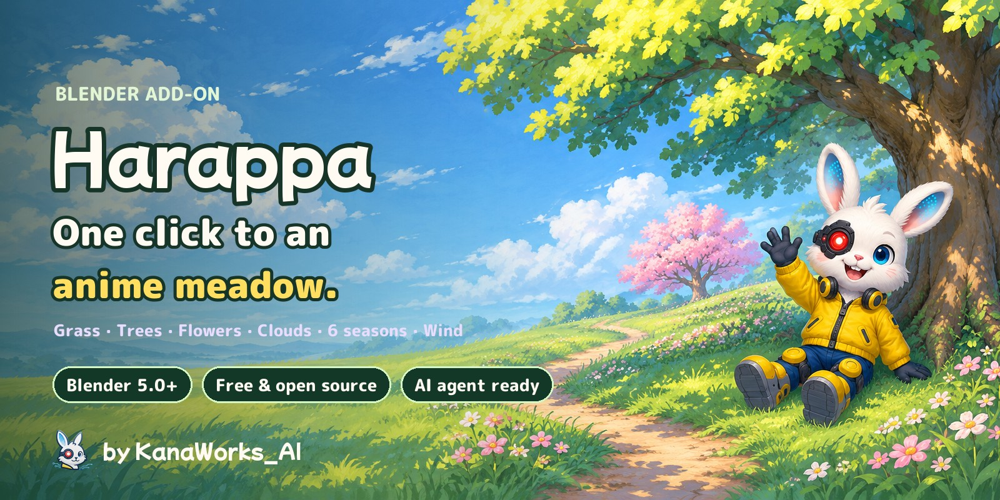
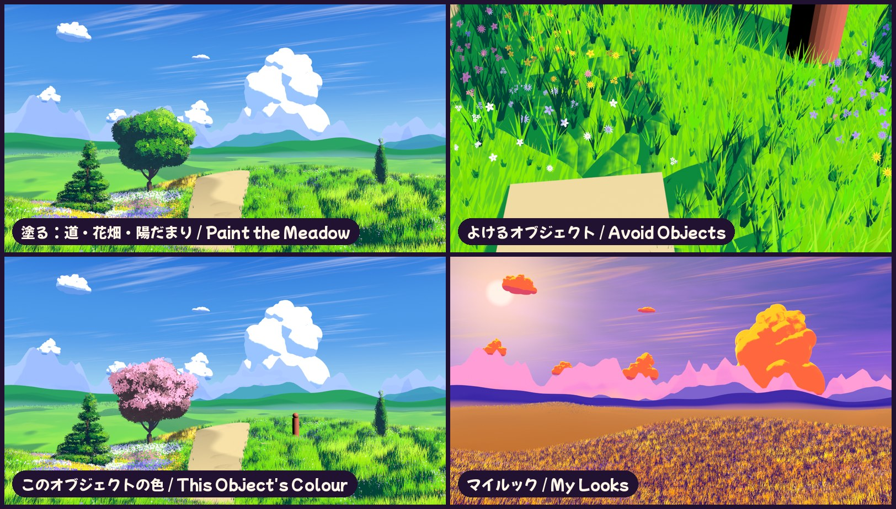
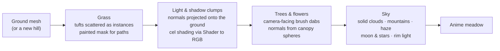

<div align="center">



<p>
  <a href="https://github.com/kanaworksai-hue/harappa/releases/latest"></a>
  
  
  
  
  <a href="LICENSE"></a>
  <a href="NOTICE.md"></a>
  <a href="https://github.com/kanaworksai-hue/harappa/stargazers"></a>
</p>

<p><a href="https://github.com/kanaworksai-hue"></a>&nbsp;<a href="https://github.com/kanaworksai-hue"><b>A KanaWorks_AI project</b></a>&nbsp;·&nbsp;<a href="#-kanaworks-add-ons">See the series</a></p>

[日本語](README.md) | **English** | [简体中文](README.zh-CN.md) | [한국어](README.ko.md) | [Español](README.es.md) | [Português](README.pt-BR.md)

[🎨 Gallery](#-gallery) · [🚀 Get started](#-get-started) · [🎛️ What you can tweak](#️-what-you-can-tweak) · [❓ FAQ](#-faq) · [⭐ Star it](#-support-with-a-star)

</div>

**Harappa** (原っぱ, "meadow") is a free Blender add-on that builds an anime-background meadow — grass, trees, flowers and sky — with one click. Every tuft of grass grows on its own and sways in the wind, while light and shadow fall in big painted clumps. Trees are made of brush-dab leaves, and the sky gets solid painted cumulus, layered distant mountains and haze.

Mix **6 seasons** (Summer Meadow, Spring Blossom, Golden Hour, Autumn Leaves, Moonlit Night, Misty Morning) with **4 paint styles** (Anime Background, Painterly, Crisp Cel, Soft Pastel). Every press of **Shuffle** changes the tree shapes, clouds and flower colours, and an AI agent can do everything from the install to the finished scene for you.

**New in 1.1:** paint paths, flower beds, tall grass and sunlit patches with a brush; let the grass make room for your characters; give any tree, cloud or meadow its own colour; and save the colours you like as a **Look** to use in any file.

<p align="center">
  
  <br><sub>Same hill, same camera. Left: nothing yet. Right: after Make Anime Meadow.</sub>
</p>

## ✨ Features

<table>
<tr>
<td align="center" width="25%"><br><b>One click</b><br><sub>Grass, flowers, sky, clouds, sun and a camera, all at once</sub></td>
<td align="center" width="25%"><br><b>Anime trees</b><br><sub>Nine shapes: round, cherry blossom, Japanese pine, willow, poplar…</sub></td>
<td align="center" width="25%"><br><b>6 seasons × 4 styles</b><br><sub>Shuffle changes trees, clouds, flower colours and light</sub></td>
<td align="center" width="25%"><br><b>Ask your AI agent</b><br><sub>One sentence: install, scene and preview, done for you</sub></td>
</tr>
</table>

- **Anime-background grass:** the grass is a field of tuft instances, so it stays light. It sways in a two-layer wind (slow waves plus a fast flutter) while streaks of light sweep across the field with the gusts. Light and shadow come from a "clump" normal field that the ground and every blade share, so shadows fall in big clumps that follow the sun. Roots are darker, tips lighter, and every blade is a little different.
- **Paint the meadow:** four brush layers — **Grass** (Make Path / Grow Grass), **Flowers** (dense flower beds / none), **Grass Height** (up to twice as tall / mown) and **Colour** (sunlit patches, dry spots). Click a layer and paint with Blender's own brush; the grass changes as you paint. Fill All, Reset Layer and Ctrl+Z work, and seasons, Shuffle and Reset keep what you painted.
- **Brush-dab trees:** the leaves are camera-facing cards of painted dabs whose normals come from the canopy spheres, so every clump splits into lit, mid, shadow and dark pockets. Nine shapes, from a round broadleaf to cherry blossom, Japanese pine, willow and poplar; Plant Trees puts a round focal tree on a third of the frame. Change the shape, height or seed and the tree rebuilds on the spot.
- **Sky, clouds and mountains:** a sky gradient that follows the camera, a sun disc and high cirrus; solid cumulus clouds (each one an object you can move, scale or delete) with a lit top, blue shade and a golden rim against the sun; up to three layers of distant mountains fading into the haze. Night brings a moon and stars; golden hour is backlit.
- **Any mesh becomes a bush:** Make Foliage turns Suzanne, a box or anything else into a hedge or bush of leaf dabs.
- **Grass grows around your characters:** select your character (or its armature) and click **Make Grass Avoid It**. Nothing grows inside it, grass next to it gets shorter and leans away, and under things that hang above the ground (a bench, a bridge) it grows up to just below them — continuous, so nothing pops when the character moves. **Use Simple Box** keeps heavy models fast.
- **Blend your own models into the meadow (1.1.1):** if an imported character or building gets pitch-black shadows, select it and click **Blend Into Meadow**. It is painted the way the meadow is, and its shadow colours follow the season and Look. Its own materials are kept: **Original Look** brings them back at any time.
- **Every object its own colour:** shift the hue, saturation and brightness of one meadow, tree, cloud or mountain range, or give it its own colour (a pink cherry among green trees). Shuffle keeps it.
- **My Looks:** save the colours, light, sky and paint style as a small JSON file and apply it to any scene; import and export looks to share them.
- **Detail Level:** Fast / Balanced / Best trades richness for speed in one click (it also sets the render samples).
- **Light and fast:** grass, leaves and flowers stay instances, so the viewport stays responsive and a 1920×1080 render takes about four seconds on an M1 Mac. Values live in node groups, so files render the same without the add-on installed.
- **UI in English, 日本語, 简体中文 and 한국어:** follows Blender's language automatically, or pick one from the 🌐 menu at the top right of the panel.

## 🎨 Gallery

### Six seasons

Same meadow, same camera — only the season changes.


### Swaying in the wind

Grass, flowers and trees all move with the waves of wind.


### Nine tree shapes


### Up close


### Four paint styles

Seasons and styles combine freely.


### Make it yours

Paint a path, a flower bed and a sunlit patch; let the grass make room for a picnic blanket and a character; turn one tree pink; put a saved look on a fresh file.



### Shuffle

Each press changes the tree shapes, the cloud layout, flower colours, grass tint and sun angle. Keep the number and you can get the same scene back any time.


### Any mesh into a bush


### Four layers


## 🧭 How it works



1. **Grass (Geometry Nodes):** tufts are scattered over the ground and kept as instances. The brush layers are colour attributes on the ground (`hrp_grass`, `hrp_flowers`, `hrp_height`, `hrp_tint`); a missing layer changes nothing. Where `hrp_grass` is black nothing grows; at its edges grass is shorter, sparser and moves less. Grass far from the camera is thinned out and made a little bigger to stay fast. The ground normal, the mask and the wind wave are stored per tuft for the shader.
2. **Light and shadow clumps (shader):** Voronoi "domes" projected straight down in world space (three sizes) are added to the ground normal, then lit through Diffuse → Shader to RGB → normalised by the key light → a 3-tone cel split. Grass and ground use the same projection, so the shadow clumps run across the whole field, and fine noise breaks the terminator into blade-like strokes. It follows the anime-grass technique of projecting a normal texture in object space; Harappa does it procedurally with nodes, no baking.
3. **Trees and flowers:** the canopy is a mesh of overlapping spheres (edit it and the tree changes shape). Its surface is covered with camera-aligned leaf cards (a brush-dab atlas drawn with numpy) whose normals come from the spheres and the whole canopy. AO and depth darken the inside, and each card gets a slightly different value so the dabs read as overlapping brush marks.
4. **Sky:** the gradient, sun and cirrus are painted in the world shader and refit to the camera. Each cloud is a cluster of puffs turned into a smooth mesh (SDF volume → mesh) and shaded per puff with a painter's light, so the lit tops, blue shade and flat base read like a background painting. Every material fades into the horizon colour with camera distance.

## 🚀 Get started

### Ask your AI agent (recommended)

If you use an AI agent that can operate your computer (Claude Code, Codex, …), just send this:

> Follow the AGENTS.md at https://github.com/kanaworksai-hue/harappa to install Harappa and build me an anime-background meadow with trees in Blender.

Then fine-tune it in plain words while you look at the preview:

- "Make it sunset."
- "One cherry tree in the middle."
- "Add a path through it."
- "More clouds."
- "Show me another version."

### Install it yourself

**You need:** Blender 5.0 or newer (tested on Blender 5.2 LTS and 5.3), with EEVEE as the render engine.

1. Download `harappa-x.y.z.zip` from [Releases](https://github.com/kanaworksai-hue/harappa/releases/latest) (don't unzip it)
2. Blender → Edit → Preferences → Get Extensions → ⌄ at the top right → **Install from Disk…** → pick the zip


### Use it

1. In the 3D view press **N** → **Harappa** tab
2. **Make Anime Meadow** (on the selected ground mesh, or on a new hill when nothing is selected)
3. **Add Anime Tree** (stands at the 3D cursor) or **Plant Trees** (scatters trees over the meadow)
4. **Paint the Meadow:** click **Grass** and paint a path (it starts on **Make Path**), **Flowers** for a flower bed, **Grass Height** or **Colour**; then **Done Painting**
5. Select your character and click **Make Grass Avoid It**; select a tree and pick an **Own Colour** in **This Object's Colour**
6. Pick a **Season** and a **Paint Style**. Can't decide? **Shuffle**. Like it? **Save Look**. Render with **F12**

<p align="center">
  
</p>

## 🎛️ What you can tweak

<details>
<summary><b>Main panel</b></summary>

| Setting | What it does |
|---|---|
| Make Anime Meadow | Grass and flowers on the selected meshes (or a new hill), plus sky, sun, clouds, far hills and a camera |
| Tree Shape / Height / Blossom → Add Anime Tree | A tree on the ground under the 3D cursor |
| Plant Trees / Trees | Scatter trees over the active meadow (keeping off paths and the camera's view) |
| Season / Paint Style | Colours, light and sky (6) / how light and shadow are painted (4) |
| Look / Save Look | Apply a saved look (or the season's default) / save the current colours, light, sky and style as a look; ⌄ for import, export, folder, delete |
| Vividness / Picture Contrast | Colour strength and contrast of the whole picture, kept when you change the season |
| Detail Level | Fast / Balanced / Best: how much grass and flowers, how fine the clouds, and the render samples |
| Variation / Shuffle | A number that re-rolls tree shapes, clouds, flower colours, tints and sun angle; 0 restores the original |
| Make Clouds / Count | Lay out new clouds (0 removes them); clouds you moved are kept |
| Distant Mountains / Layers | Up to three layers of mountains around the meadow (again for new shapes, 0 removes them) |
| Make Grass Avoid It | Shown when your own mesh or armature is selected: the grass makes room for it |
| Blend Into Meadow / Original Look | Shown when your own model is selected: paint it like the meadow (no black shadows) / give it its own materials back |
| Make Foliage | Turn the selected meshes into bushes or hedges of leaf dabs |
| Anime Sky & Sun | Switch to EEVEE, the Standard view, the anime sky and a key sun |
| Remove Grass / Reset to Defaults | Take grass, flowers and leaves off the selected objects and restore their materials / Summer, Anime Background, no variation |

</details>

<details>
<summary><b>Paint the Meadow, Avoid Objects, This Object's Colour, Active Meadow / Tree / Cloud</b></summary>

| Group | Settings |
|---|---|
| Paint the Meadow | Layers Grass / Flowers / Grass Height / Colour; per layer two actions (Make Path – Grow Grass, More Flowers – No Flowers, Taller – Shorter, Paint – Remove) and Smooth; Brush Strength, Paint Colour + season swatches, Fill All / Erase All, Reset Layer, Done Painting; Make Ground Finer for your own coarse ground |
| Avoid Objects | Avoid Selected / Stop Avoiding, the list, Clear Space, Shortest Grass, Use Simple Box; under More: Reaches Down From, Avoid Collection |
| This Object's Colour | Hue / Saturation / Brightness Shift, Own Colour + Amount, Blossom on This Tree, Copy to Selected, Back to Scene Colours |
| Grass | Density, Height, Height Random, Width, Edge Shrink, LOD Distance, Seed |
| Wind | Wind Strength, Speed, Scale, Direction, Edge Wind |
| Flowers | Density, Patch Size, Patch Amount, Size, Height, Seed |
| Tree | Tree Shape, Leaf Style, Height, Seed (changing them rebuilds the tree), New Shape |
| Leaves | Density, Leaf Size, Size Random, Inflate, Roundness, Blossom, Blossom Scale, Fill Inside, Seed |
| Shape Canopy | Move or add canopy spheres in Edit Mode; the leaves follow live |
| Active Cloud | New Shape, Tower, Cloud Width, Bump Size, Give Back to Auto Layout |

</details>

<details>
<summary><b>Light & Sky, Brushwork, Colours</b></summary>

| Group | Settings |
|---|---|
| Light & Sky | Sun Height and Direction, Light / Shadow Split, Deep Shadow Split, Edge Softness, Rim Light, Haze (amount, start, end), sky colours |
| Brushwork | Clump Size and Strength, Small Clumps, Brush Jitter, Dark Roots, Light Tips, Wind Sheen, Colour Patches, Leaf Pockets, Leaf Highlights |
| Colours | Every colour of the grass, path, leaves, blossoms and bark, clouds and flowers |

Seasons only change colour-and-light values and styles only change technique values, so any season combines with any style.
</details>

## ❓ FAQ

<details>
<summary><b>Does it work in Cycles?</b></summary>

No. It uses EEVEE's Shader to RGB node, so render with EEVEE. Making your first meadow or tree switches the scene to EEVEE.
</details>

<details>
<summary><b>When I orbit the viewport, leaves and clouds look like thin cards.</b></summary>

Leaf, flower and cloud cards face the **scene camera** (the same as the anime-tree technique it's based on). Check the look through the camera (Numpad 0) and render from the camera; move the camera and the cards follow.
</details>

<details>
<summary><b>Can I grow grass on my own ground?</b></summary>

Yes. Select your ground mesh and press Make Anime Meadow. Painting needs vertices: if your ground is a coarse plane, **Make Ground Finer** in Paint the Meadow adds them in one step (your painting is kept). Remove Grass gives you your original material back.
</details>

<details>
<summary><b>Won't it be heavy?</b></summary>

Grass, leaves and clouds stay instances, and far grass is thinned out automatically. If it's slow, lower the Density in Active Meadow or shorten the LOD Distance. Render samples are set to 16, which is plenty for cel shading.
</details>

<details>
<summary><b>Can I use the images and videos I make commercially?</b></summary>

Yes. Renders and videos made with Harappa are your own work and free to use, commercially too. The GPL applies to the add-on's code, not to what you make with it. No credit is required, but `Made with Harappa by @KanaWorks_AI` is always appreciated.
</details>

## 📝 Credit

Harappa is free, commercial use included.

**When you redistribute, modify or bundle the add-on** (forks, modified versions, ports, packs or products that include it, free or paid), keeping this line unchanged in the add-on's description and its documentation is **required** (an additional term under GPLv3 section 7(b); see [NOTICE.md](NOTICE.md)):

```
Harappa by KanaWorks_AI (@KanaWorks_AI) — https://github.com/kanaworksai-hue/harappa
```

**Images and videos you make** need no credit. If you'd like to add one, this line in the post or description is very welcome:

```
Made with Harappa by @KanaWorks_AI
```

## ⭐ Support with a star

If you like Harappa, a **⭐ Star** at the top right of the [repository page](https://github.com/kanaworksai-hue/harappa) means a lot. It's free and takes one second.

- **It reaches more people:** more stars make it easier to find on GitHub.
- **It keeps updates coming:** it's real motivation for new tree shapes and seasons.

Bug reports and feature ideas in [Issues](https://github.com/kanaworksai-hue/harappa/issues), and your renders tagged [@KanaWorks_AI](https://x.com/KanaWorks_AI) on X, are just as welcome.

## 🧩 KanaWorks add-ons

Free, open-source Blender add-ons by the same author. Every one of them works with a one-sentence request to an AI agent.

<table>
<tr>
<td align="center" width="50%"><a href="https://github.com/kanaworksai-hue/harappa"></a><br><b>Harappa</b> (this page)<br><sub>Anime-background meadows, trees, flowers and sky in one click</sub></td>
<td align="center" width="50%"><a href="https://github.com/kanaworksai-hue/senga-sketch"></a><br><b><a href="https://github.com/kanaworksai-hue/senga-sketch">Senga Sketch</a></b><br><sub>3D into pen-and-ink line art: hatching, pencil, engraving, screentone</sub></td>
</tr>
<tr>
<td align="center" width="50%"><a href="https://github.com/kanaworksai-hue/painterly-25d"></a><br><b><a href="https://github.com/kanaworksai-hue/painterly-25d">Painterly 2.5D</a></b><br><sub>3D into hand-painted art: oil, watercolour, crayon, anime cel</sub></td>
<td align="center" width="50%"><a href="https://github.com/kanaworksai-hue/kirapaint"></a><br><b><a href="https://github.com/kanaworksai-hue/kirapaint">KiraPaint</a></b><br><sub>3D into sparkly painterly 2.5D: crushed-diamond gloss and starlight</sub></td>
</tr>
<tr>
<td align="center" width="50%"><a href="https://github.com/kanaworksai-hue/mochitoon"></a><br><b><a href="https://github.com/kanaworksai-hue/mochitoon">MochiToon</a></b><br><sub>3D into a cute comic look: coloured shadows, heart and star halftones</sub></td>
<td align="center" width="50%"></td>
</tr>
</table>

## 🛠️ Development

```bash
# Headless tests (every feature on scenes it was never tuned for; tests/run_matrix.sh runs several Blenders)
blender -b --factory-startup --python tests/test_generic.py
blender -b --factory-startup --python tests/test_custom.py

# Build the installable zip into dist/
BLENDER=blender ./build.sh
```

```
harappa/
  __init__.py      settings, seasons, styles, variation, operators
  shading.py       shaders (palette, grass clump normals, cel shading, ground/grass/flower/leaf/bark/cloud, haze)
  scatter.py       Geometry Nodes (wind, grass, flowers, leaf and cloud cards)
  tree.py          trunk and canopy generator, asset objects
  cumulus.py       solid cumulus clouds and their layout
  ridges.py        distant mountain layers
  layers.py        brush layers (Paint the Meadow)
  avoid.py         Avoid Objects
  look.py          This Object's Colour
  looks.py         My Looks (save / apply / import / export)
  quality.py       Detail Level
  clouds.py        far hills (and the 1.0 card clouds)
  assets.py        grass tuft, cards, numpy-drawn leaf/flower/cloud atlases
  scene.py         EEVEE settings, anime sky (moon and stars), key sun
  presets.py       seasons and styles
  build.py         turn a ground into a meadow
  ui.py / i18n.py  panel and UI translations (日本語, English, 简体中文, 한국어)
agent/harappa_agent.py  command line for AI agents
```

## 📄 License & credits

- **This add-on:** Copyright © 2026 東京AI映像合同会社 (Tokyo AI Visuals LLC), released under [GPL-3.0-or-later](LICENSE) with an additional attribution term for redistribution ([NOTICE.md](NOTICE.md)).
- **Brand:** the KanaWorks_AI name, logo and the character Kana belong to 東京AI映像合同会社 and are **not** covered by the GPL. See [docs/brand](docs/brand/README.md).
- The grass and tree look builds on techniques widely shared in the Blender anime-background community: projected normals that give a meadow coherent shadow clumps, camera-facing leaf cards with normals from spheres, and cel shading through Shader to RGB. We learned a lot from Trung Duy Nguyen's ([@trungduyng](https://www.youtube.com/@trungduyng)) anime grass and tree tutorials. All of Harappa's nodes and code are written from scratch, and every texture is drawn procedurally by the add-on.
- **Blender** is a trademark of the Blender Foundation. This is an independent project, not affiliated with or endorsed by the Blender Foundation.

<br>

<div align="center">

<a href="https://x.com/KanaWorks_AI"></a>

<p><b>Made with ♥ by <a href="https://x.com/KanaWorks_AI">KanaWorks_AI</a></b></p>

<p><sub>If Harappa helped you, a ⭐ keeps the next update coming. More projects: <a href="https://github.com/kanaworksai-hue">github.com/kanaworksai-hue</a></sub></p>

</div>
