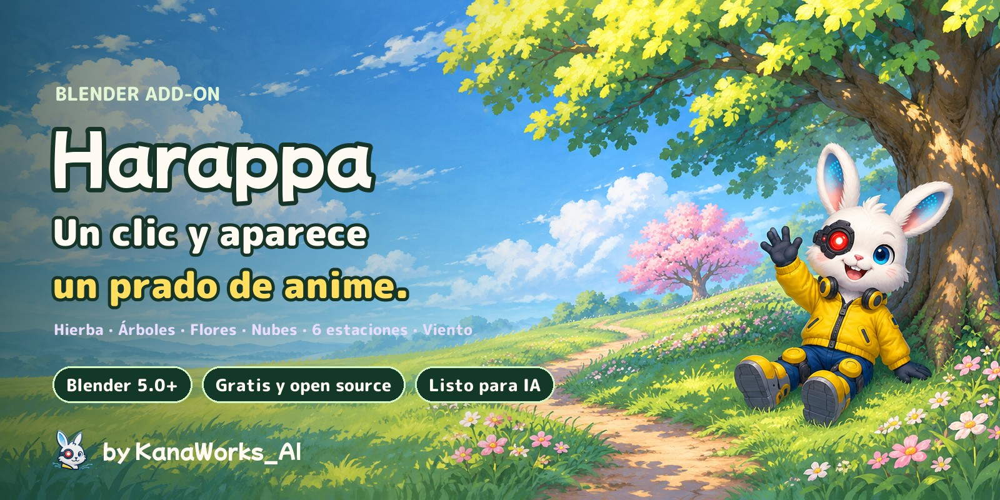
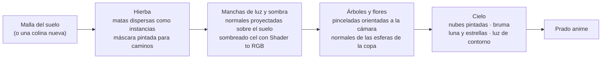

<div align="center">



<p>
  <a href="https://github.com/kanaworksai-hue/harappa/releases/latest"></a>
  
  
  
  
  <a href="LICENSE"></a>
  <a href="NOTICE.md"></a>
  <a href="https://github.com/kanaworksai-hue/harappa/stargazers"></a>
</p>

<p><a href="https://github.com/kanaworksai-hue"></a>&nbsp;<a href="https://github.com/kanaworksai-hue"><b>Un proyecto de KanaWorks_AI</b></a>&nbsp;·&nbsp;<a href="#-complementos-de-kanaworks">Ver la serie</a></p>

[日本語](README.md) | [English](README.en.md) | [简体中文](README.zh-CN.md) | [한국어](README.ko.md) | [Português](README.pt-BR.md) | **Español**

[🎨 Galería](#-galería) · [🚀 Primeros pasos](#-primeros-pasos) · [🎛️ Qué puedes ajustar](#️-qué-puedes-ajustar) · [❓ Preguntas frecuentes](#-preguntas-frecuentes) · [⭐ Dale una estrella](#-apoya-con-una-estrella)

</div>

**Harappa** (原っぱ, "prado") es un complemento gratuito para Blender que crea un prado al estilo de los fondos de anime —hierba, árboles, flores y cielo— con un solo clic. Cada mata de hierba crece por su cuenta y se mece con el viento, mientras la luz y la sombra caen en grandes manchas pintadas. Los árboles están hechos de hojas en pinceladas, y el cielo lleva cúmulos pintados y bruma en la lejanía.

Combina **6 estaciones** (Summer Meadow, Spring Blossom, Golden Hour, Autumn Leaves, Moonlit Night, Misty Morning) con **4 estilos de pintura** (Anime Background, Painterly, Crisp Cel, Soft Pastel). Cada vez que pulsas **Shuffle** (mezclar) cambian las formas de los árboles, las nubes y los colores de las flores, y un agente de IA puede hacerlo todo por ti, desde la instalación hasta la escena terminada.

<p align="center">
  
  <br><sub>La misma colina y la misma cámara. Izquierda: todavía nada. Derecha: después de Make Anime Meadow.</sub>
</p>

## ✨ Características

<table>
<tr>
<td align="center" width="25%"><br><b>Un solo clic</b><br><sub>Hierba, flores, cielo, nubes, sol y cámara, todo a la vez</sub></td>
<td align="center" width="25%"><br><b>Árboles de anime</b><br><sub>Redondos, altos, anchos tipo cerezo, arbustos y coníferas</sub></td>
<td align="center" width="25%"><br><b>6 estaciones × 4 estilos</b><br><sub>Shuffle cambia árboles, nubes, colores de las flores y luz</sub></td>
<td align="center" width="25%"><br><b>Pídeselo a tu agente de IA</b><br><sub>Una sola frase: instalación, escena y vista previa, hechas por ti</sub></td>
</tr>
</table>

- **Hierba de fondo de anime:** la hierba es un campo de instancias de matas, así que sigue siendo ligera. Se mece con un viento de dos capas (ondas lentas más un aleteo rápido), mientras franjas de luz recorren el campo con cada ráfaga. La luz y la sombra salen de un campo de normales en "manchas" que comparten el suelo y cada brizna, de modo que las sombras caen en grandes manchas que siguen al sol. Las raíces son más oscuras, las puntas más claras y cada brizna es un poco distinta.
- **Los caminos son solo pintura:** Paint Path (pintar camino) cambia a Vertex Paint; donde pintes de negro, la hierba se aparta y deja un sendero de tierra. Los bordes se deshilachan de forma natural y la hierba ahí crece más corta y más rala.
- **Árboles de pinceladas:** las hojas son tarjetas orientadas a la cámara con toques pintados, cuyas normales vienen de las esferas de la copa, así que cada mata se divide en zonas iluminadas, medias, en sombra y oscuras. Las flores brotan en racimos en el lado soleado y, en primavera, florecen todos los árboles y arbustos. Cambia la forma, la altura o la semilla y el árbol se reconstruye al instante.
- **Cielo, nubes y bruma:** los cúmulos pintados se colocan lejos de las copas de los árboles y de los bordes del encuadre, y lo distante se funde con el color del horizonte. La noche trae luna y estrellas; la hora dorada pone una luz cálida en los bordes de los árboles.
- **Cualquier malla se convierte en arbusto:** Make Foliage (crear follaje) convierte a Suzanne, una caja o cualquier otra cosa en un seto o un arbusto de pinceladas de hojas.
- **La hierba rodea a tus personajes:** pon una colección en la entrada **Avoid** de los modificadores Harappa Grass / Harappa Flowers y no crecerá nada debajo de esos objetos. La hierba de al lado se acorta y se inclina hacia fuera, así que un personaje tumbado en el prado parece acurrucado en él, sin briznas que atraviesen el modelo.
- **Ligero y rápido:** la hierba, las hojas y las nubes siguen siendo instancias, así que el visor responde con fluidez y un render a 1920×1080 tarda segundos. Los valores viven en grupos de nodos, por lo que los archivos se renderizan igual sin el complemento instalado.
- **Interfaz en English, 日本語, 简体中文 y 한국어:** sigue automáticamente el idioma de Blender, o elige uno en el menú 🌐 arriba a la derecha del panel.

## 🎨 Galería

### Seis estaciones

El mismo prado y la misma cámara: solo cambia la estación.


### Meciéndose con el viento

La hierba, las flores y los árboles se mueven con las ondas del viento.


### Cinco formas de árbol


### De cerca


### Cuatro estilos de pintura

Las estaciones y los estilos se combinan libremente.


### Shuffle

Cada pulsación cambia las formas de los árboles, la disposición de las nubes, los colores de las flores, el tono de la hierba y el ángulo del sol. Guarda el número y podrás recuperar la misma escena cuando quieras.


### Cualquier malla en arbusto


### Cuatro capas


## 🧭 Cómo funciona



1. **Hierba (Geometry Nodes):** las matas se dispersan sobre el suelo y se mantienen como instancias. Donde la máscara pintada (atributo de color `hrp_grass`) es negra no crece nada; en sus bordes la hierba es más corta, más rala y se mueve menos. La hierba lejos de la cámara se aclara y se hace un poco más grande para mantener la velocidad. La normal del suelo, la máscara y la onda del viento se guardan por mata para el shader.
2. **Manchas de luz y sombra (shader):** "cúpulas" de Voronoi proyectadas en vertical en el espacio del mundo (en tres tamaños) se suman a la normal del suelo y luego se iluminan mediante Diffuse → Shader to RGB → normalización por la luz principal → una división cel en 3 tonos. La hierba y el suelo usan la misma proyección, así que las manchas de sombra recorren todo el campo, y un ruido fino rompe la línea de transición en trazos parecidos a briznas. Sigue la técnica de la hierba de anime que proyecta una textura de normales en el espacio del objeto; Harappa lo hace de forma procedural con nodos, sin horneado.
3. **Árboles y flores:** la copa es una malla de esferas superpuestas (edítala y el árbol cambia de forma). Su superficie está cubierta de tarjetas de hojas alineadas con la cámara (un atlas de pinceladas dibujado con numpy) cuyas normales vienen de las esferas y de toda la copa. La oclusión ambiental y la profundidad oscurecen el interior, y cada tarjeta recibe un valor ligeramente distinto para que los toques se lean como pinceladas superpuestas.
4. **Cielo:** las nubes usan la misma técnica de tarjetas, sombreadas con una normal esférica por nube calculada desde el centro de cada una, de modo que los bordes esponjosos conservan el aspecto dibujado a mano mientras la sombra se lee como una sola masa. Todos los materiales se funden con el color del horizonte según la distancia a la cámara.

## 🚀 Primeros pasos

### Pídeselo a tu agente de IA (recomendado)

Si usas un agente de IA capaz de operar tu ordenador (Claude Code, Codex, …), solo envíale esto:

> Sigue el AGENTS.md de https://github.com/kanaworksai-hue/harappa para instalar Harappa y crearme en Blender un prado con árboles al estilo de un fondo de anime.

Después ajústalo con palabras sencillas mientras miras la vista previa:

- "Ponlo al atardecer."
- "Un cerezo en el centro."
- "Añade un camino que lo atraviese."
- "Más nubes."
- "Enséñame otra versión."

### Instálalo tú mismo

**Necesitas:** Blender 5.0 o posterior (probado en Blender 5.2 LTS y 5.3), con EEVEE como motor de render.

1. Descarga `harappa-x.y.z.zip` desde [Releases](https://github.com/kanaworksai-hue/harappa/releases/latest) (no lo descomprimas)
2. Blender → Edit → Preferences → Get Extensions → ⌄ arriba a la derecha → **Install from Disk…** (instalar desde disco) → elige el zip


### Úsalo

1. En la vista 3D pulsa **N** → pestaña **Harappa**
2. **Make Anime Meadow** (crear prado anime; sobre la malla de suelo seleccionada, o sobre una colina nueva si no hay nada seleccionado)
3. **Add Anime Tree** (añadir árbol anime; aparece en el cursor 3D) o **Plant Trees** (plantar árboles; los dispersa por el prado)
4. Para un camino, usa **Paint Path** en Active Meadow y pinta de negro
5. Elige una **Season** (estación) y un **Paint Style** (estilo de pintura). ¿No te decides? **Shuffle**. Renderiza con **F12**

<p align="center">
  
</p>

## 🎛️ Qué puedes ajustar

<details>
<summary><b>Panel principal</b></summary>

| Ajuste | Qué hace |
|---|---|
| Make Anime Meadow | Hierba y flores en las mallas seleccionadas (o en una colina nueva), además de cielo, sol, nubes, colinas lejanas y una cámara |
| Tree Shape / Height / Blossom → Add Anime Tree | Un árbol sobre el suelo bajo el cursor 3D |
| Plant Trees / Trees | Dispersa árboles por el prado activo (evitando los caminos y la vista de la cámara) |
| Season / Paint Style | Colores, luz y cielo (6) / cómo se pintan la luz y la sombra (4) |
| Variation / Shuffle | Un número que vuelve a sortear formas de árboles, nubes, colores de las flores, tonos y ángulo del sol; 0 restaura el original |
| Add Clouds / Clouds | Reconstruye los cúmulos pintados (0 los elimina) |
| Make Foliage | Convierte las mallas seleccionadas en arbustos o setos de pinceladas de hojas |
| Anime Sky & Sun | Cambia a EEVEE, a la vista Standard, al cielo anime y a un sol principal |
| Remove Grass / Reset to Defaults | Quita la hierba, las flores y las hojas de los objetos seleccionados y restaura sus materiales / Summer, Anime Background, sin variación |

</details>

<details>
<summary><b>Active Meadow y Active Tree</b></summary>

| Grupo | Ajustes |
|---|---|
| Paint Path / Paint Grass | Pintura de vértices: negro = camino, blanco = hierba |
| Grass | Density, Height, Height Random, Width, Edge Shrink, LOD Distance, Seed |
| Wind | Wind Strength, Speed, Scale, Direction, Edge Wind |
| Flowers | Density, Patch Size, Patch Amount, Size, Height, Seed |
| Tree | Tree Shape, Leaf Style, Height, Seed (al cambiarlos se reconstruye el árbol), New Shape |
| Leaves | Density, Leaf Size, Size Random, Inflate, Roundness, Blossom, Blossom Scale, Fill Inside, Seed |
| Tint | Hue Shift y Brightness por árbol |
| Shape Canopy | Mueve o añade esferas de la copa en Edit Mode; las hojas las siguen en tiempo real |

</details>

<details>
<summary><b>Light & Sky, Brushwork, Colours</b></summary>

| Grupo | Ajustes |
|---|---|
| Light & Sky | Sun Height y Direction, Light / Shadow Split, Deep Shadow Split, Edge Softness, Rim Light, Haze (cantidad, inicio, fin), colores del cielo |
| Brushwork | Clump Size y Strength, Small Clumps, Brush Jitter, Dark Roots, Light Tips, Wind Sheen, Colour Patches, Leaf Pockets, Leaf Highlights |
| Colours | Todos los colores de la hierba, el camino, las hojas, las flores de los árboles y la corteza, las nubes y las flores |

Las estaciones solo cambian valores de color y luz, y los estilos solo cambian valores de técnica, así que cualquier estación se combina con cualquier estilo.
</details>

## ❓ Preguntas frecuentes

<details>
<summary><b>¿Funciona en Cycles?</b></summary>

No. Usa el nodo Shader to RGB de EEVEE, así que renderiza con EEVEE. Al crear tu primer prado o árbol, la escena cambia a EEVEE.
</details>

<details>
<summary><b>Cuando giro el visor, las hojas y las nubes parecen tarjetas finas.</b></summary>

Las tarjetas de hojas, flores y nubes miran hacia la **cámara de la escena** (igual que en la técnica de árboles de anime en la que se basa). Comprueba el aspecto a través de la cámara (Numpad 0) y renderiza desde la cámara; si mueves la cámara, las tarjetas la siguen.
</details>

<details>
<summary><b>¿Puedo hacer crecer hierba en mi propio suelo?</b></summary>

Sí. Selecciona tu malla de suelo y pulsa Make Anime Meadow. Para pintar un camino hacen falta vértices, así que subdivide primero un plano simple. Remove Grass te devuelve tu material original.
</details>

<details>
<summary><b>¿No será muy pesado?</b></summary>

La hierba, las hojas y las nubes siguen siendo instancias, y la hierba lejana se aclara automáticamente. Si va lento, baja la Density en Active Meadow o acorta la LOD Distance. Las muestras de render están en 16, que es más que suficiente para el sombreado cel.
</details>

<details>
<summary><b>¿Puedo usar comercialmente las imágenes y vídeos que cree?</b></summary>

Sí. Los renders y vídeos hechos con Harappa son obra tuya y puedes usarlos libremente, también con fines comerciales. La GPL se aplica al código del complemento, no a lo que crees con él. No se exige crédito, pero `Made with Harappa by @KanaWorks_AI` siempre se agradece.
</details>

## 📝 Créditos

Harappa es gratuito, incluido el uso comercial.

**Si redistribuyes, modificas o incluyes el complemento** (forks, versiones modificadas, adaptaciones, packs o productos que lo incluyan, gratuitos o de pago), es **obligatorio** mantener esta línea sin cambios en la descripción del complemento y en su documentación (un término adicional según la sección 7(b) de la GPLv3; consulta [NOTICE.md](NOTICE.md)):

```
Harappa by KanaWorks_AI (@KanaWorks_AI) — https://github.com/kanaworksai-hue/harappa
```

**Las imágenes y vídeos que crees** no necesitan crédito. Si quieres añadirlo, esta línea en la publicación o en la descripción es muy bienvenida:

```
Made with Harappa by @KanaWorks_AI
```

## ⭐ Apoya con una estrella

Si te gusta Harappa, una **⭐ Star** arriba a la derecha de la [página del repositorio](https://github.com/kanaworksai-hue/harappa) significa mucho. Es gratis y lleva un segundo.

- **Llega a más gente:** con más estrellas es más fácil encontrarlo en GitHub.
- **Mantiene vivas las actualizaciones:** es una motivación real para nuevas formas de árbol y nuevas estaciones.

Los informes de errores y las ideas de funciones en [Issues](https://github.com/kanaworksai-hue/harappa/issues), y tus renders etiquetando a [@KanaWorks_AI](https://x.com/KanaWorks_AI) en X, son igual de bienvenidos.

## 🧩 Complementos de KanaWorks

Complementos de Blender gratuitos y de código abierto del mismo autor. Todos funcionan con una petición de una sola frase a un agente de IA.

<table>
<tr>
<td align="center" width="50%"><a href="https://github.com/kanaworksai-hue/harappa"></a><br><b>Harappa</b> (esta página)<br><sub>Prados, árboles, flores y cielo de fondo de anime en un solo clic</sub></td>
<td align="center" width="50%"><a href="https://github.com/kanaworksai-hue/senga-sketch"></a><br><b><a href="https://github.com/kanaworksai-hue/senga-sketch">Senga Sketch</a></b><br><sub>De 3D a dibujo de línea a tinta: tramado, lápiz, grabado, trama</sub></td>
</tr>
<tr>
<td align="center" width="50%"><a href="https://github.com/kanaworksai-hue/painterly-25d"></a><br><b><a href="https://github.com/kanaworksai-hue/painterly-25d">Painterly 2.5D</a></b><br><sub>De 3D a arte pintado a mano: óleo, acuarela, cera, cel de anime</sub></td>
<td align="center" width="50%"><a href="https://github.com/kanaworksai-hue/kirapaint"></a><br><b><a href="https://github.com/kanaworksai-hue/kirapaint">KiraPaint</a></b><br><sub>De 3D a pintura 2.5D brillante: destellos de diamante triturado y luz de estrellas</sub></td>
</tr>
<tr>
<td align="center" width="50%"><a href="https://github.com/kanaworksai-hue/mochitoon"></a><br><b><a href="https://github.com/kanaworksai-hue/mochitoon">MochiToon</a></b><br><sub>De 3D a un estilo de cómic adorable: sombras de color, semitonos de corazones y estrellas</sub></td>
<td align="center" width="50%"></td>
</tr>
</table>

## 🛠️ Desarrollo

```bash
# Headless test (every feature on a scene it was never tuned for)
blender -b --factory-startup --python tests/test_generic.py

# Build the installable zip into dist/
BLENDER=blender ./build.sh
```

```
harappa/
  __init__.py      settings, seasons, styles, variation, operators
  shading.py       shaders (palette, grass clump normals, cel shading, ground/grass/flower/leaf/bark/cloud, haze)
  scatter.py       Geometry Nodes (wind, grass, flowers, leaf and cloud cards)
  tree.py          trunk and canopy generator, asset objects
  clouds.py        cloud placement and far hills
  assets.py        grass tuft, cards, numpy-drawn leaf/flower/cloud atlases
  scene.py         EEVEE settings, anime sky (moon and stars), key sun
  presets.py       seasons and styles
  build.py         turn a ground into a meadow
  ui.py / i18n.py  panel and UI translations (日本語, English, 简体中文, 한국어)
agent/harappa_agent.py  command line for AI agents
```

## 📄 Licencia y créditos

- **Este complemento:** Copyright © 2026 東京AI映像合同会社 (Tokyo AI Visuals LLC), publicado bajo [GPL-3.0-or-later](LICENSE) con un término adicional de atribución para la redistribución ([NOTICE.md](NOTICE.md)).
- **Marca:** el nombre KanaWorks_AI, el logotipo y el personaje Kana pertenecen a 東京AI映像合同会社 y **no** están cubiertos por la GPL. Consulta [docs/brand](docs/brand/README.md).
- El aspecto de la hierba y los árboles se basa en técnicas ampliamente compartidas en la comunidad de fondos de anime de Blender: normales proyectadas que dan a un prado manchas de sombra coherentes, tarjetas de hojas orientadas a la cámara con normales tomadas de esferas, y sombreado cel mediante Shader to RGB. Aprendimos mucho de los tutoriales de hierba y árboles de anime de Trung Duy Nguyen ([@trungduyng](https://www.youtube.com/@trungduyng)). Todos los nodos y el código de Harappa están escritos desde cero, y cada textura la dibuja el complemento de forma procedural.
- **Blender** es una marca registrada de la Blender Foundation. Este es un proyecto independiente, sin afiliación ni respaldo de la Blender Foundation.

<br>

<div align="center">

<a href="https://x.com/KanaWorks_AI"></a>

<p><b>Hecho con ♥ por <a href="https://x.com/KanaWorks_AI">KanaWorks_AI</a></b></p>

<p><sub>Si Harappa te ha ayudado, una ⭐ hace posible la próxima actualización. Más proyectos: <a href="https://github.com/kanaworksai-hue">github.com/kanaworksai-hue</a></sub></p>

</div>
