<div align="center">

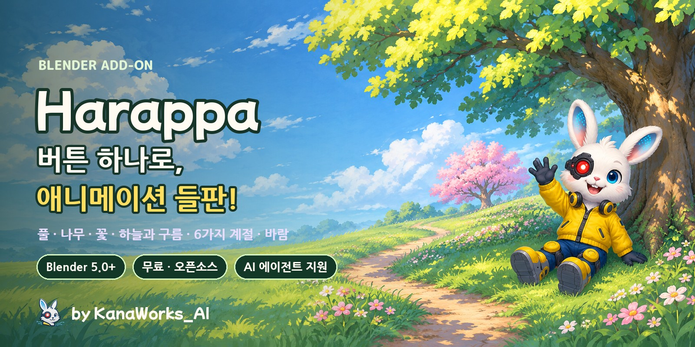

<p>
  <a href="https://github.com/kanaworksai-hue/harappa/releases/latest"></a>
  
  
  
  
  <a href="LICENSE"></a>
  <a href="NOTICE.md"></a>
  <a href="https://github.com/kanaworksai-hue/harappa/stargazers"></a>
</p>

<p><a href="https://github.com/kanaworksai-hue"></a>&nbsp;<a href="https://github.com/kanaworksai-hue"><b>KanaWorks_AI 프로젝트</b></a>&nbsp;·&nbsp;<a href="#-kanaworks-애드온">시리즈 보기</a></p>

[日本語](README.md) | [English](README.en.md) | [简体中文](README.zh-CN.md) | **한국어** | [Português](README.pt-BR.md) | [Español](README.es.md)

[🎨 갤러리](#-갤러리) · [🚀 시작하기](#-시작하기) · [🎛️ 조정할 수 있는 항목](#️-조정할-수-있는-항목) · [❓ 자주 묻는 질문](#-자주-묻는-질문) · [⭐ 별 누르기](#-별로-응원하기)

</div>

**Harappa**(原っぱ, '들판')는 풀, 나무, 꽃, 하늘까지 애니메이션 배경 같은 초원을 클릭 한 번으로 만들어 주는 무료 Blender 애드온입니다. 풀포기 하나하나가 따로 자라나 바람에 흔들리고, 빛과 그림자는 붓으로 칠한 듯 큼직한 덩어리로 떨어집니다. 나무는 붓터치로 그린 잎으로 이루어지고, 하늘에는 손으로 그린 듯한 뭉게구름과 먼 곳의 연무가 더해집니다.

**6가지 계절**(여름 초원, 봄꽃, 골든아워, 가을 단풍, 달밤, 안개 낀 아침)과 **4가지 화풍**(애니 배경, 회화풍, 선명한 셀, 부드러운 파스텔)을 자유롭게 조합할 수 있습니다. **섞기**를 누를 때마다 나무 모양, 구름, 꽃 색이 바뀌고, 설치부터 장면 완성까지 전부 AI 에이전트에게 맡길 수도 있습니다.

<p align="center">
  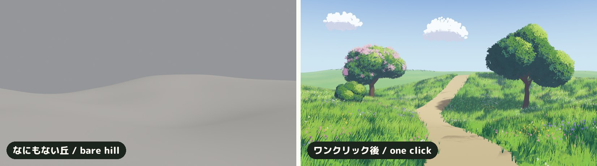
  <br><sub>같은 언덕, 같은 카메라. 왼쪽: 아직 아무것도 없음. 오른쪽: 「애니 초원 만들기」 후.</sub>
</p>

## ✨ 주요 기능

<table>
<tr>
<td align="center" width="25%"><br><b>클릭 한 번</b><br><sub>풀, 꽃, 하늘, 구름, 태양, 카메라까지 한꺼번에</sub></td>
<td align="center" width="25%">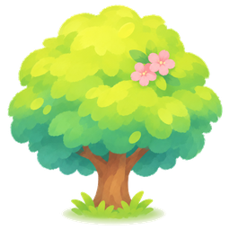<br><b>애니풍 나무</b><br><sub>둥근 나무, 키 큰 나무, 벚나무형 넓은 나무, 덤불, 침엽수</sub></td>
<td align="center" width="25%"><br><b>6계절 × 4화풍</b><br><sub>섞기로 나무, 구름, 꽃 색, 빛이 바뀝니다</sub></td>
<td align="center" width="25%"><br><b>AI 에이전트에게 부탁</b><br><sub>한 문장이면 설치, 장면, 미리보기까지 알아서</sub></td>
</tr>
</table>

- **애니 배경 같은 풀:** 풀은 풀포기 인스턴스로 이루어진 들판이라 가볍습니다. 2단 바람(느린 물결 + 빠른 살랑임)에 흔들리고, 돌풍이 불면 빛줄기가 풀밭을 훑고 지나갑니다. 빛과 그림자는 땅과 모든 풀잎이 공유하는 '덩어리' 노멀에서 나오기 때문에, 그림자가 태양을 따라 큼직한 덩어리로 떨어집니다. 뿌리는 어둡고 끝은 밝으며, 풀잎마다 조금씩 다릅니다.
- **길은 칠하기만 하면 끝:** 「길 칠하기」를 누르면 버텍스 페인트로 전환되고, 검정으로 칠한 곳은 풀이 사라져 흙길이 됩니다. 길 가장자리는 자연스럽게 흐트러지고, 그 근처 풀은 더 짧고 성기게 자랍니다.
- **붓터치로 그린 나무:** 잎은 카메라를 향한 붓터치 카드이고, 노멀은 수관의 구에서 가져오기 때문에 잎 덩어리마다 밝은 면, 중간, 그림자, 짙은 어둠으로 나뉩니다. 꽃은 햇빛 받는 쪽에 송이송이 피고, 봄에는 모든 나무와 덤불에 꽃이 핍니다. 모양, 높이, 시드를 바꾸면 그 자리에서 나무가 다시 만들어집니다.
- **하늘, 구름, 연무:** 그림 같은 뭉게구름은 나무 꼭대기와 화면 가장자리를 피해 배치되고, 먼 것일수록 지평선 색으로 흐려집니다. 밤에는 달과 별이 뜨고, 골든아워에는 나무 가장자리에 따뜻한 빛이 걸립니다.
- **어떤 메시든 덤불로:** 「잎으로 만들기」를 쓰면 수잔(Suzanne)이든 박스든 무엇이든 잎 터치로 된 울타리나 덤불이 됩니다.
- **캐릭터와 바위를 피해 자라는 풀:** 풀과 꽃 모디파이어(Harappa Grass / Harappa Flowers)의 **Avoid** 입력에 컬렉션을 넣으면 그 안의 오브젝트 아래에는 풀이 자라지 않습니다. 주변 풀은 짧아지고 바깥쪽으로 누워서, 풀밭에 누운 캐릭터가 풀에 폭 파묻힌 것처럼 보이고 풀잎이 모델을 뚫고 나오지도 않습니다.
- **가볍고 빠르게:** 풀, 잎, 구름은 인스턴스 그대로라 뷰포트가 쾌적하고, 1920×1080 렌더도 몇 초면 끝납니다. 값은 노드 그룹에 저장되므로 애드온이 설치되지 않은 환경에서도 똑같이 렌더링됩니다.
- **UI는 English, 日本語, 简体中文, 한국어 지원:** Blender의 언어 설정을 자동으로 따르며, 패널 오른쪽 위의 🌐 메뉴에서 직접 고를 수도 있습니다.

## 🎨 갤러리

### 여섯 계절

같은 초원, 같은 카메라. 계절만 바꿨습니다.

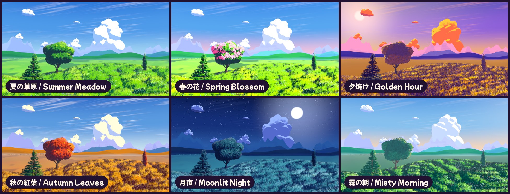

### 바람에 흔들리는 초원

풀도 꽃도 나무도 바람의 물결을 따라 움직입니다.

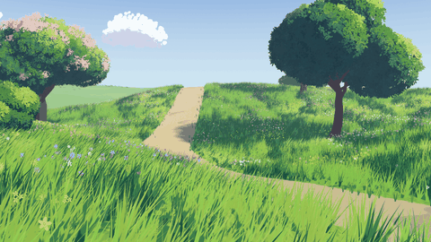

### 다섯 가지 나무 모양

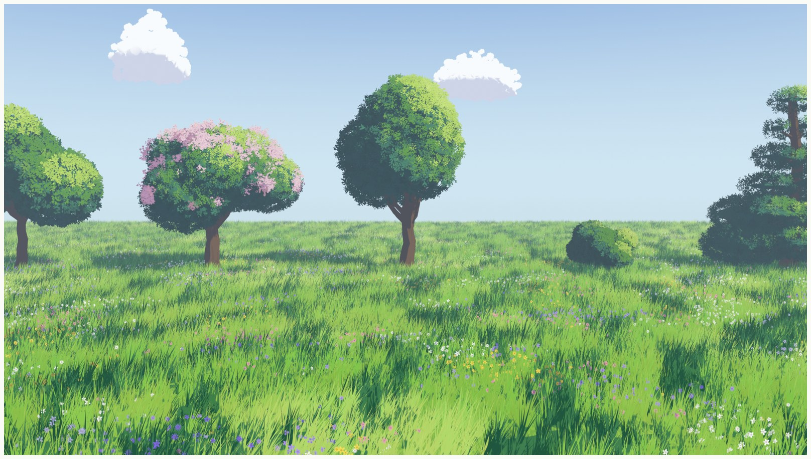

### 가까이서 보기

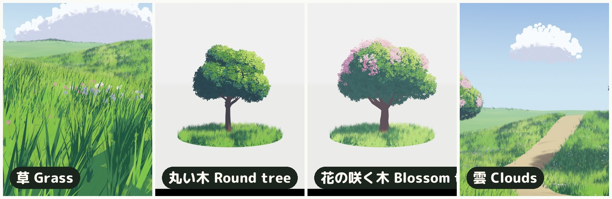

### 네 가지 화풍

계절과 화풍은 자유롭게 조합할 수 있습니다.

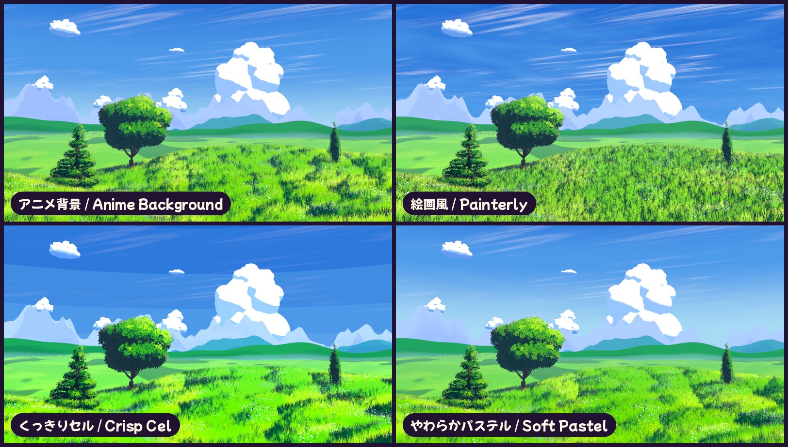

### 섞기

누를 때마다 나무 모양, 구름 배치, 꽃 색, 풀 색조, 태양 각도가 바뀝니다. 번호만 기억해 두면 언제든 같은 장면으로 돌아올 수 있습니다.

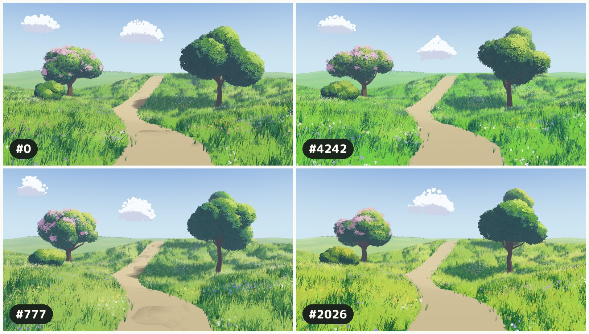

### 어떤 메시든 덤불로

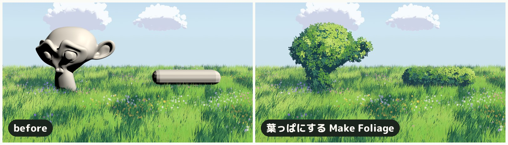

### 네 개의 레이어

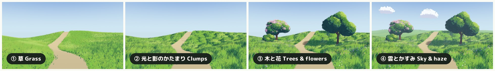

## 🧭 작동 원리


1. **풀 (Geometry Nodes):** 풀포기를 지면에 흩뿌리고 인스턴스 그대로 유지합니다. 칠한 마스크(색 속성 `hrp_grass`)가 검정인 곳에는 아무것도 자라지 않고, 그 경계에서는 풀이 더 짧고 성기며 덜 흔들립니다. 카메라에서 먼 풀은 솎아 내고 조금 크게 만들어 속도를 유지합니다. 지면 노멀, 마스크, 바람 물결은 셰이더용으로 풀포기마다 저장됩니다.
2. **빛과 그림자 덩어리 (셰이더):** 월드 공간에서 바로 아래로 투영한 Voronoi '돔'(세 가지 크기)을 지면 노멀에 더한 뒤, Diffuse → Shader to RGB → 키 라이트로 정규화 → 3톤 셀 분할 순서로 조명합니다. 풀과 지면이 같은 투영을 쓰기 때문에 그림자 덩어리가 들판 전체에 걸쳐 이어지고, 잔 노이즈가 명암 경계를 풀잎 같은 붓자국으로 깨뜨립니다. 오브젝트 공간에 노멀 텍스처를 투영하는 애니 풀 기법을 따르되, Harappa는 이를 베이크 없이 노드만으로 절차적으로 처리합니다.
3. **나무와 꽃:** 수관은 서로 겹친 구들로 이루어진 메시입니다(편집하면 나무 모양이 바뀝니다). 그 표면을 카메라 정렬 잎 카드(numpy로 그린 붓터치 아틀라스)가 덮고, 노멀은 각 구와 수관 전체에서 가져옵니다. AO와 깊이가 안쪽을 어둡게 하고, 카드마다 명도를 조금씩 달리해 붓자국이 겹쳐 보이게 합니다.
4. **하늘:** 구름도 같은 카드 기법을 쓰되, 구름마다 중심에서 계산한 구 노멀로 셰이딩하기 때문에 몽글몽글한 가장자리는 손그림 느낌을 유지하면서 그림자는 하나의 덩어리로 읽힙니다. 모든 머티리얼은 카메라와의 거리에 따라 지평선 색으로 흐려집니다.

## 🚀 시작하기

### AI 에이전트에게 맡기기 (추천)

컴퓨터를 조작할 수 있는 AI 에이전트(Claude Code, Codex 등)를 쓰고 있다면, 이렇게만 보내면 됩니다.

> https://github.com/kanaworksai-hue/harappa 의 AGENTS.md를 따라 Harappa를 설치하고, Blender에서 나무가 있는 애니 배경풍 초원을 만들어 줘.

그다음에는 미리보기를 보면서 평소 말투로 다듬어 가면 됩니다.

- "노을 지는 저녁으로 바꿔 줘."
- "가운데에 벚나무 한 그루."
- "초원을 가로지르는 길을 내 줘."
- "구름을 더 많이."
- "다른 버전도 보여 줘."

### 직접 설치하기

**필요한 것:** Blender 5.0 이상(Blender 5.2 LTS와 5.3에서 동작 확인), 렌더 엔진은 EEVEE.

1. [Releases](https://github.com/kanaworksai-hue/harappa/releases/latest)에서 `harappa-x.y.z.zip`을 다운로드합니다(압축은 풀지 마세요)
2. Blender → 편집(Edit) → 환경 설정(Preferences) → 확장 기능 받기(Get Extensions) → 오른쪽 위의 ⌄ → **디스크에서 설치…(Install from Disk…)** → zip 파일 선택

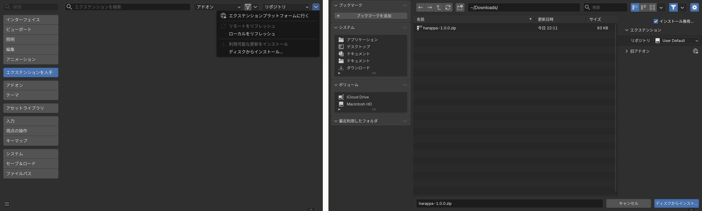

### 사용법

1. 3D 뷰포트에서 **N** 키 → **Harappa** 탭
2. **애니 초원 만들기**(선택한 지면 메시에, 아무것도 선택하지 않았으면 새 언덕에 만듭니다)
3. **애니 나무 추가**(3D 커서 위치에 세웁니다) 또는 **나무 심기**(초원 곳곳에 나무를 심습니다)
4. 길을 내려면 「선택한 초원」의 **길 칠하기**로 검정을 칠합니다
5. **계절**과 **화풍**을 고릅니다. 고민된다면 **섞기**. **F12**로 렌더링

<p align="center">
  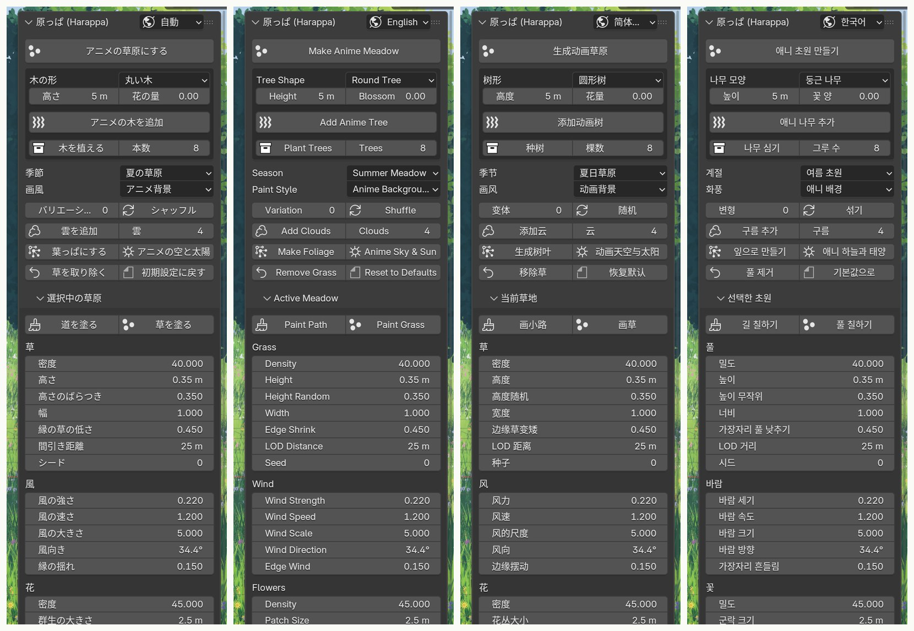
</p>

## 🎛️ 조정할 수 있는 항목

<details>
<summary><b>메인 패널</b></summary>

| 설정 | 하는 일 |
|---|---|
| 애니 초원 만들기 | 선택한 메시(또는 새 언덕)에 풀과 꽃을 만들고, 하늘, 태양, 구름, 먼 언덕, 카메라도 준비합니다 |
| 나무 모양 / 높이 / 꽃 양 → 애니 나무 추가 | 3D 커서 아래 지면에 나무 한 그루를 세웁니다 |
| 나무 심기 / 그루 수 | 선택한 초원에 나무를 흩어 심습니다(길과 카메라 시야는 피합니다) |
| 계절 / 화풍 | 색, 빛, 하늘(6가지) / 빛과 그림자를 그리는 방식(4가지) |
| 변형 / 섞기 | 나무 모양, 구름, 꽃 색, 색조, 태양 각도를 다시 뽑는 번호. 0이면 원래대로 돌아갑니다 |
| 구름 추가 / 구름 | 그림 같은 뭉게구름을 다시 만듭니다(0이면 삭제) |
| 잎으로 만들기 | 선택한 메시를 잎 터치로 된 덤불이나 울타리로 바꿉니다 |
| 애니 하늘과 태양 | EEVEE, 표준(Standard) 뷰, 애니 하늘, 키 태양으로 전환합니다 |
| 풀 제거 / 기본값으로 | 선택한 오브젝트에서 풀, 꽃, 잎을 없애고 머티리얼을 되돌립니다 / 여름 초원, 애니 배경, 변형 없음 |

</details>

<details>
<summary><b>선택한 초원과 선택한 나무</b></summary>

| 그룹 | 설정 |
|---|---|
| 길 칠하기 / 풀 칠하기 | 버텍스 페인트: 검정 = 길, 흰색 = 풀 |
| 풀 | 밀도, 높이, 높이 무작위, 너비, 가장자리 풀 낮추기, LOD 거리, 시드 |
| 바람 | 바람 세기, 바람 속도, 바람 크기, 바람 방향, 가장자리 흔들림 |
| 꽃 | 밀도, 군락 크기, 군락 양, 크기, 높이, 시드 |
| 나무 | 나무 모양, 잎 모양, 높이, 시드(바꾸면 나무가 다시 만들어집니다), 다른 모양 |
| 잎 | 밀도, 잎 크기, 크기 무작위, 부풀리기, 둥글기, 꽃 양, 꽃 무리 크기, 안쪽 채우기, 시드 |
| 색조 | 나무별 색상 이동과 밝기 |
| 수관 다듬기 | 편집 모드에서 수관의 구를 옮기거나 추가하면 잎이 실시간으로 따라옵니다 |

</details>

<details>
<summary><b>빛과 하늘, 붓터치, 색상</b></summary>

| 그룹 | 설정 |
|---|---|
| 빛과 하늘 | 태양 높이와 태양 방향, 빛/그림자 경계, 짙은 그림자 경계, 경계 부드러움, 림 라이트, 연무(양, 연무 시작, 연무 끝), 하늘 색 |
| 붓터치 | 풀 덩어리 크기와 덩어리 강도, 작은 덩어리, 붓 흔들림, 뿌리 어둡게, 밝은 풀끝, 바람 광택, 색 얼룩, 잎 사이 어둠, 잎 하이라이트 |
| 색상 | 풀, 길, 잎, 꽃잎과 줄기, 구름, 꽃의 모든 색 |

계절은 색과 빛에 관한 값만, 화풍은 표현 기법에 관한 값만 바꾸기 때문에 어떤 계절이든 어떤 화풍과도 조합할 수 있습니다.
</details>

## ❓ 자주 묻는 질문

<details>
<summary><b>Cycles에서도 쓸 수 있나요?</b></summary>

아니요. EEVEE의 Shader to RGB 노드를 사용하므로 EEVEE로 렌더링해 주세요. 처음으로 초원이나 나무를 만들면 장면이 EEVEE로 전환됩니다.
</details>

<details>
<summary><b>뷰포트를 돌려 보면 잎과 구름이 얇은 카드처럼 보여요.</b></summary>

잎, 꽃, 구름 카드는 **씬 카메라**를 향합니다(바탕이 된 애니 나무 기법과 같습니다). 카메라 시점(넘패드 0)에서 확인하고 카메라로 렌더링해 주세요. 카메라를 옮기면 카드도 따라 돌아갑니다.
</details>

<details>
<summary><b>내가 만든 지면에도 풀을 키울 수 있나요?</b></summary>

네. 지면 메시를 선택하고 「애니 초원 만들기」를 누르세요. 길을 칠하려면 버텍스가 필요하므로, 평면 하나뿐이라면 먼저 세분화(Subdivide)해 주세요. 「풀 제거」를 누르면 원래 머티리얼로 돌아갑니다.
</details>

<details>
<summary><b>무겁지 않나요?</b></summary>

풀, 잎, 구름은 인스턴스 그대로이고, 먼 풀은 자동으로 솎아 냅니다. 느리다면 「선택한 초원」에서 「밀도」를 낮추거나 「LOD 거리」를 줄여 보세요. 렌더 샘플은 16으로 설정되어 있으며, 셀 셰이딩에는 이것으로 충분합니다.
</details>

<details>
<summary><b>만든 이미지나 영상을 상업적으로 써도 되나요?</b></summary>

네. Harappa로 만든 렌더 이미지와 영상은 여러분의 작품이며, 상업적 용도를 포함해 자유롭게 쓸 수 있습니다. GPL은 애드온의 코드에 적용될 뿐, 애드온으로 만든 결과물에는 적용되지 않습니다. 크레딧 표기는 필요 없지만 `Made with Harappa by @KanaWorks_AI`라고 적어 주시면 언제나 큰 힘이 됩니다.
</details>

## 📝 크레딧

Harappa는 상업적 이용을 포함해 무료입니다.

**애드온을 재배포, 수정 또는 번들링할 때는**(포크, 수정판, 이식판, 애드온을 포함한 팩이나 제품 등 유료·무료 불문) 애드온 설명과 문서에 다음 한 줄을 그대로 남기는 것이 **필수**입니다(GPLv3 제7조 (b)에 따른 추가 조항, [NOTICE.md](NOTICE.md) 참고).

```
Harappa by KanaWorks_AI (@KanaWorks_AI) — https://github.com/kanaworksai-hue/harappa
```

**직접 만든 이미지와 영상**에는 크레딧이 필요 없습니다. 넣어 주신다면 게시물이나 설명란에 이 한 줄을 적어 주시면 정말 기쁩니다.

```
Made with Harappa by @KanaWorks_AI
```

## ⭐ 별로 응원하기

Harappa가 마음에 드셨다면 [저장소 페이지](https://github.com/kanaworksai-hue/harappa) 오른쪽 위의 **⭐ Star**를 눌러 주세요. 큰 힘이 됩니다. 무료이고 1초면 끝납니다.

- **더 많은 사람에게 닿습니다:** 별이 많을수록 GitHub에서 찾기 쉬워집니다.
- **업데이트가 계속됩니다:** 새 나무 모양과 계절을 만드는 진짜 원동력이 됩니다.

버그 제보나 기능 아이디어는 [Issues](https://github.com/kanaworksai-hue/harappa/issues)에, 직접 만든 렌더는 X에서 [@KanaWorks_AI](https://x.com/KanaWorks_AI)를 태그해 올려 주셔도 똑같이 반갑습니다.

## 🧩 KanaWorks 애드온

같은 제작자가 만든 무료 오픈소스 Blender 애드온입니다. 모두 AI 에이전트에게 한 문장으로 부탁하기만 하면 됩니다.

<table>
<tr>
<td align="center" width="50%"><a href="https://github.com/kanaworksai-hue/harappa">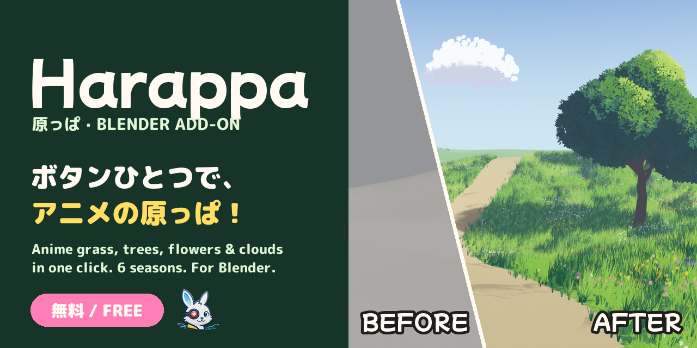</a><br><b>Harappa</b> (이 페이지)<br><sub>애니 배경풍 초원, 나무, 꽃, 하늘을 클릭 한 번으로</sub></td>
<td align="center" width="50%"><a href="https://github.com/kanaworksai-hue/senga-sketch"></a><br><b><a href="https://github.com/kanaworksai-hue/senga-sketch">Senga Sketch</a></b><br><sub>3D를 펜화 선화로: 해칭, 연필, 판화, 스크린톤</sub></td>
</tr>
<tr>
<td align="center" width="50%"><a href="https://github.com/kanaworksai-hue/painterly-25d"></a><br><b><a href="https://github.com/kanaworksai-hue/painterly-25d">Painterly 2.5D</a></b><br><sub>3D를 손으로 칠한 그림으로: 유화, 수채화, 크레용, 애니 셀</sub></td>
<td align="center" width="50%"><a href="https://github.com/kanaworksai-hue/kirapaint"></a><br><b><a href="https://github.com/kanaworksai-hue/kirapaint">KiraPaint</a></b><br><sub>3D를 반짝이는 회화풍 2.5D로: 다이아몬드 가루 같은 광택과 별빛</sub></td>
</tr>
<tr>
<td align="center" width="50%"><a href="https://github.com/kanaworksai-hue/mochitoon"></a><br><b><a href="https://github.com/kanaworksai-hue/mochitoon">MochiToon</a></b><br><sub>3D를 귀여운 코믹풍으로: 컬러 그림자, 하트와 별 하프톤</sub></td>
<td align="center" width="50%"></td>
</tr>
</table>

## 🛠️ 개발

```bash
# 헤드리스 테스트 (조정한 적 없는 장면에서 모든 기능 확인)
blender -b --factory-startup --python tests/test_generic.py

# 설치용 zip을 dist/에 빌드
BLENDER=blender ./build.sh
```

```
harappa/
  __init__.py      설정, 계절, 화풍, 변형, 오퍼레이터
  shading.py       셰이더 (팔레트, 풀 덩어리 노멀, 셀 셰이딩, 지면·풀·꽃·잎·줄기·구름, 연무)
  scatter.py       Geometry Nodes (바람, 풀, 꽃, 잎과 구름 카드)
  tree.py          줄기와 수관 생성, 에셋 오브젝트
  clouds.py        구름 배치와 먼 언덕
  assets.py        풀포기, 카드, numpy로 그린 잎·꽃·구름 아틀라스
  scene.py         EEVEE 설정, 애니 하늘 (달과 별), 키 태양
  presets.py       계절과 화풍
  build.py         지면을 초원으로 만들기
  ui.py / i18n.py  패널과 UI 번역 (日本語, English, 简体中文, 한국어)
agent/harappa_agent.py  AI 에이전트용 커맨드 라인
```

## 📄 라이선스 및 크레딧

- **이 애드온:** Copyright © 2026 東京AI映像合同会社 (Tokyo AI Visuals LLC). [GPL-3.0-or-later](LICENSE)로 공개되며, 재배포 시 출처 표기에 관한 추가 조항이 있습니다([NOTICE.md](NOTICE.md)).
- **브랜드:** KanaWorks_AI라는 이름, 로고, 캐릭터 Kana는 東京AI映像合同会社의 소유이며 GPL의 적용 대상이 **아닙니다**. [docs/brand](docs/brand/README.md)를 참고하세요.
- 풀과 나무의 표현은 Blender 애니 배경 커뮤니티에서 널리 공유되어 온 기법을 바탕으로 합니다. 초원에 일관된 그림자 덩어리를 만드는 투영 노멀, 구에서 노멀을 가져오는 카메라 방향 잎 카드, Shader to RGB를 이용한 셀 셰이딩 등입니다. 특히 Trung Duy Nguyen([@trungduyng](https://www.youtube.com/@trungduyng)) 님의 애니 풀과 나무 튜토리얼에서 많은 것을 배웠습니다. Harappa의 노드와 코드는 모두 처음부터 직접 작성했으며, 모든 텍스처는 애드온이 절차적으로 그립니다.
- **Blender**는 Blender Foundation의 상표입니다. 이 프로젝트는 독립 프로젝트이며 Blender Foundation과 제휴하거나 보증을 받은 것이 아닙니다.

<br>

<div align="center">

<a href="https://x.com/KanaWorks_AI"></a>

<p><b>Made with ♥ by <a href="https://x.com/KanaWorks_AI">KanaWorks_AI</a></b></p>

<p><sub>Harappa가 도움이 되셨다면 ⭐ 하나가 다음 업데이트의 힘이 됩니다. 다른 프로젝트: <a href="https://github.com/kanaworksai-hue">github.com/kanaworksai-hue</a></sub></p>

</div>
