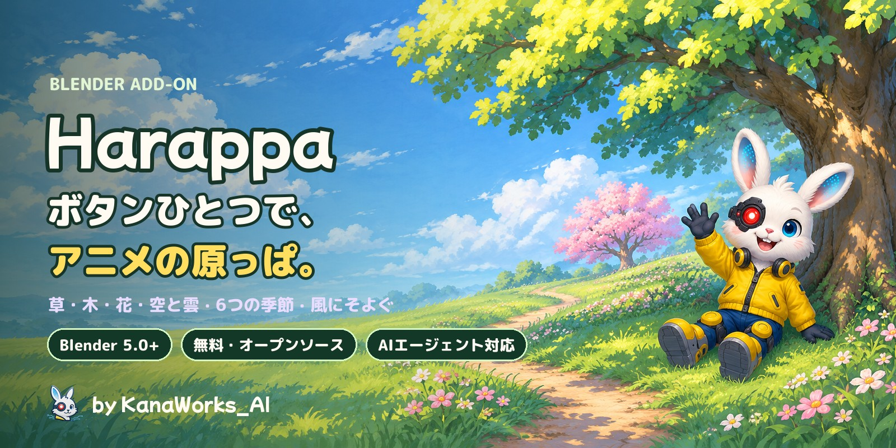
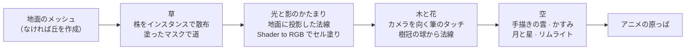

<div align="center">



<p>
  <a href="https://github.com/kanaworksai-hue/harappa/releases/latest"></a>
  
  
  
  
  <a href="LICENSE"></a>
  <a href="NOTICE.md"></a>
  <a href="https://github.com/kanaworksai-hue/harappa/stargazers"></a>
</p>

<p><a href="https://github.com/kanaworksai-hue"></a>&nbsp;<a href="https://github.com/kanaworksai-hue"><b>KanaWorks_AI のプロジェクト</b></a>&nbsp;·&nbsp;<a href="#-kanaworks-のアドオン">シリーズ一覧</a></p>

**日本語** | [English](README.en.md) | [简体中文](README.zh-CN.md) | [한국어](README.ko.md) | [Português](README.pt-BR.md) | [Español](README.es.md)

[🎨 ギャラリー](#-ギャラリー) · [🚀 はじめかた](#-はじめかた) · [🎛️ 調整できること](#️-調整できること) · [❓ FAQ](#-faq) · [⭐ Star で応援](#-star-で応援する)

</div>

**Harappa（原っぱ）** は、アニメ背景のような草原・木・花・空を、ボタンひとつで作れる無料の Blender アドオンです。草は一本一本生えて風にそよぎ、光と影は大きな「草のかたまり」で塗り分けられます。木は筆で置いたような葉っぱのタッチで描かれ、空には手描き風の雲と遠くのかすみがかかります。

**夏・春・夕暮れ・秋・月夜・霧の朝**の6つの季節と、**アニメ背景・絵画風・くっきりセル・やわらかパステル**の4つの画風を組み合わせられます。**シャッフル**を押すたびに木の形や雲や花の色が変わり、インストールから景色づくりまで AI エージェントに一言で頼むこともできます。

<p align="center">
  
  <br><sub>同じ丘、同じカメラ。左がなにもない状態、右が「アニメの草原にする」を押したあと。</sub>
</p>

## ✨ 特長

<table>
<tr>
<td align="center" width="25%"><br><b>ワンクリック</b><br><sub>草・花・空・雲・太陽・カメラまで一括で用意</sub></td>
<td align="center" width="25%"><br><b>アニメの木</b><br><sub>丸い木・高い木・桜のような木・茂み・針葉樹</sub></td>
<td align="center" width="25%"><br><b>季節6種 × 画風4種</b><br><sub>シャッフルで木の形・雲・花の色・光が変わる</sub></td>
<td align="center" width="25%"><br><b>AIにおまかせ</b><br><sub>エージェントに一言。インストールから景色づくりまで</sub></td>
</tr>
</table>

- **アニメ背景の草：** 草は一本ずつ生えた「株」のインスタンスなので軽く、二層の風（ゆっくりした波と細かい揺れ）でそよぎ、風の波に合わせて光の筋が草原を渡ります。光と影は、地面と草が共有する「草のかたまり」の法線で塗り分けるので、影が大きなかたまりになって太陽の向きに合わせて動きます。根元は暗く、先は明るく、一本ずつ少しずつ色が違います。
- **道は塗るだけ：** 「道を塗る」で頂点ペイントに切り替わり、黒く塗ったところの草が消えて土の小道になります。道のふちは自然にほつれ、草は低く、まばらになります。
- **筆のタッチの木：** 葉っぱはいつもカメラを向いた「筆で置いたタッチ」のカードで、法線は樹冠の球から取るので、ひとかたまりずつ日なた・中間・影・奥の暗がりに塗り分けられます。花は房になって日の当たる側に咲き、春には木と茂みにいっせいに咲きます。形・高さ・シードを変えると、その場で木が作り直されます。
- **空と雲とかすみ：** 手描き風の積雲は木の樹冠や画面の端にかからないように置かれ、遠くのものは地平線の色にかすみます。夜には月と星、夕暮れには木の輪郭に暖かい光が入ります。
- **どんなメッシュでも茂みに：** 「葉っぱにする」で、スザンヌでも箱でも、生け垣や茂みになります。
- **キャラクターや岩をよけて生える：** 草と花のモディファイアー（Harappa Grass / Harappa Flowers）の **Avoid** 入力にコレクションを入れると、その中のオブジェクトの下には草が生えません。まわりの草は短くなって外側へ倒れるので、原っぱに寝ころぶキャラクターが草にうもれて見え、草がモデルを突き抜けることもありません。
- **軽くて速い：** 草も葉も雲もインスタンスのままなので、ビューポートでも軽く、1920×1080 のレンダリングは数秒です。値はノードグループに保存されるので、アドオンがない環境でも同じ見た目でレンダリングできます。
- **UI は 日本語・English・简体中文・한국어：** Blender の言語設定に自動で合わせます。パネル右上の 🌐 メニューで個別に切り替えることもできます。

## 🎨 ギャラリー

### 6つの季節

同じ原っぱ、同じカメラ。季節だけを切り替えました。


### 風にそよぐ

草も花も木も、風の波に合わせて揺れます。


### 5つの木の形


### 近くで見ると


### 4つの画風

季節と画風は別々に選べます。


### シャッフル

押すたびに、木の形・雲の配置・花の色・草の色味・太陽の角度が変わります。番号を覚えておけば、同じ景色をいつでも再現できます。


### どんなメッシュも茂みに


### 4つのレイヤー


## 🧭 しくみ



1. **草（ジオメトリノード）：** 地面に「株」を散布し、インスタンスのまま保ちます。塗ったマスク（カラー属性 `hrp_grass`）が黒いところには生えず、ふちでは低く、まばらに、揺れも小さくなります。カメラから遠い草は間引いて少し大きくし、速さを保ちます。地面の法線・マスク・風の波は株ごとに属性として保存され、シェーダーが読みます。
2. **光と影のかたまり（シェーダー）：** 世界座標で真上から投影した Voronoi の「丘」（大・中・小の3層）を地面の法線に足した法線で、Diffuse → Shader to RGB → 光の強さで正規化 → 3段のセル塗りをします。草と地面が同じ投影を使うので、影のかたまりが草原全体にまたがります。細かいノイズで影の境目を草の葉のようにほぐします。参考にしたのは、法線テクスチャを物体空間で投影するアニメ草原の手法で、Harappa ではそれをベイクなしの手続き的なノードで行います。
3. **木と花：** 樹冠は重なった球のメッシュ（編集すれば木の形が変わります）。その表面に、カメラの向きにそろえた葉のカード（numpy で描いた筆のタッチのアトラス）を並べ、法線は球と樹冠全体から取ります。AO と奥行きで奥を暗くし、カードごとに明るさを少しずつ変えて、筆のタッチが重なって見えるようにしています。
4. **空：** 雲も同じカードの手法で作り、雲ごとの中心から計算した「球の法線」で陰影をつけるので、パフの縁は手描き風のまま、陰はひとつのかたまりになります。すべてのマテリアルはカメラからの距離で地平線の色にかすみます。

## 🚀 はじめかた

### AI エージェントに頼む（おすすめ）

Claude Code や Codex のような、パソコンを操作できる AI エージェントにこう送るだけです。

> https://github.com/kanaworksai-hue/harappa の AGENTS.md に従って Harappa をインストールして、アニメ背景みたいな原っぱと木の景色を Blender で作って。

そのあとは、プレビューを見ながら一言で直せます。

- 「夕暮れにして」
- 「桜の木を一本、真ん中に」
- 「道を通して」
- 「雲を増やして」
- 「別のパターンも見せて」

### 自分でインストールする

**必要なもの：** Blender 5.0 以降（Blender 5.2 LTS と 5.3 で動作確認済み）、レンダーエンジンは EEVEE。

1. [Releases](https://github.com/kanaworksai-hue/harappa/releases/latest) から `harappa-x.y.z.zip` をダウンロード（解凍しないでください）
2. Blender → 編集 → プリファレンス → エクステンションを入手 → 右上の ⌄ → **ディスクからインストール…** → zip を選択


### 使い方

1. 3D ビューで **N** キー → **Harappa** タブ
2. **アニメの草原にする**（地面のメッシュを選んでおけばそこに、何も選んでいなければ新しい丘に）
3. **アニメの木を追加**（3D カーソルの位置に立ちます）か、**木を植える**（草原に散らして植えます）
4. 道を通すなら「選択中の草原」の **道を塗る** で黒く塗る
5. **季節**と**画風**を選ぶ。迷ったら **シャッフル**。**F12** でレンダリング

<p align="center">
  
</p>

## 🎛️ 調整できること

<details>
<summary><b>メインパネル</b></summary>

| 項目 | 内容 |
|---|---|
| アニメの草原にする | 選択中のメッシュ（なければ新しい丘）に草と花。空・太陽・雲・遠くの丘・カメラも用意 |
| 木の形 / 高さ / 花の量 → アニメの木を追加 | 3D カーソルの位置の地面に木を立てる |
| 木を植える / 本数 | 選択中の草原に木を散らして植える（道とカメラの前は避ける） |
| 季節 / 画風 | 色と光と空（6種）/ 光と影の描き方（4種） |
| バリエーション / シャッフル | 木の形・雲・花の色・色味・太陽の角度を振り直す番号。0 で元どおり |
| 雲を追加 / 雲の数 | 手描き風の積雲を作り直す（0 で削除） |
| 葉っぱにする | 選択中のメッシュを葉のタッチの茂み・生け垣に |
| アニメの空と太陽 | EEVEE・標準ビュー・アニメの空・キーの太陽に切り替え |
| 草を取り除く / 初期設定に戻す | 選択中のオブジェクトから草・花・葉を外してマテリアルを戻す / 夏・アニメ背景・バリエーションなしに |

</details>

<details>
<summary><b>選択中の草原・選択中の木</b></summary>

| グループ | 項目 |
|---|---|
| 道を塗る / 草を塗る | 頂点ペイントで黒＝道、白＝草 |
| 草 | 密度・高さ・高さのばらつき・幅・縁の草の低さ・間引き距離・シード |
| 風 | 風の強さ・速さ・大きさ・向き・縁の揺れ |
| 花 | 密度・群生の大きさ・群生の量・大きさ・高さ・シード |
| 木 | 木の形・葉の形・高さ・シード（変えるとその場で作り直し）・別の形にする |
| 葉 | 密度・葉の大きさ・ばらつき・ふくらみ・まとまり・花の量・花のかたまりの大きさ・内側を塗る・シード |
| 色味 | 木ごとの色相のずれと明るさ |
| 樹冠を形づくる | 樹冠の球を編集モードで動かす・増やすと、葉がその場でついてくる |

</details>

<details>
<summary><b>光と空・筆致・色</b></summary>

| グループ | 項目 |
|---|---|
| 光と空 | 太陽の高さと向き・光と影の境目・濃い影の境目・境目のやわらかさ・リムライト・かすみ（量・始まり・終わり）・空の色 |
| 筆致 | 草の塊の大きさと強さ・小さな塊・筆のゆらぎ・根元の暗さ・明るい草先・風の光・色むら・葉の奥の暗がり・葉のハイライト |
| 色 | 草・道・葉・花びらと幹・雲・花の色をすべて個別に |

季節は「色と光」の値だけを、画風は「描き方」の値だけを変えるので、自由に組み合わせられます。
</details>

## ❓ FAQ

<details>
<summary><b>Cycles でも使えますか？</b></summary>

使えません。EEVEE 専用の「Shader to RGB」ノードを使っているため、EEVEE でレンダリングしてください。最初の草原や木を作ると EEVEE に切り替わります。
</details>

<details>
<summary><b>ビューポートを回すと葉っぱや雲が薄い板に見えます。</b></summary>

葉・花・雲のカードは**シーンのカメラ**の方を向くように作られています（参考にしたアニメの木の手法と同じです）。カメラビュー（テンキー 0）で確認し、カメラからレンダリングしてください。カメラを動かせば、カードもついてきます。
</details>

<details>
<summary><b>自分の地面に草を生やせますか？</b></summary>

はい。地面のメッシュを選んでから「アニメの草原にする」を押してください。道を塗るには頂点が必要なので、1枚の平面なら細分化しておくと塗りやすくなります。元のマテリアルは「草を取り除く」で戻せます。
</details>

<details>
<summary><b>重くなりませんか？</b></summary>

草・葉・雲はインスタンスのままで、遠くの草は自動で間引かれます。重いときは「選択中の草原」の密度を下げるか、間引き距離を短くしてください。レンダリングのサンプル数は 16 に設定されます（セル塗りなのでこれで十分です）。
</details>

<details>
<summary><b>作った画像や動画は商用で使えますか？</b></summary>

はい。Harappa で作ったレンダリング画像や動画は、あなたの作品として自由に使えます。GPL が適用されるのはアドオン本体のコードで、それを使って作った作品には及びません。クレジットは必要ありませんが、`Made with Harappa by @KanaWorks_AI` と入れてもらえると嬉しいです。
</details>

## 📝 クレジット表記

Harappa は無料で、商用でも使えます。

**アドオンを再配布・改変・同梱するとき**（フォーク、改変版、移植版、パックや製品への同梱など。有償・無償を問いません）は、次の表記をアドオンの説明文とドキュメントにそのまま残すことが**必須**です（GPL-3.0 第7条(b)に基づく追加条項。詳しくは [NOTICE.md](NOTICE.md)）。

```
Harappa by KanaWorks_AI (@KanaWorks_AI) — https://github.com/kanaworksai-hue/harappa
```

**作った画像や動画**にはクレジットは必要ありません。よければ投稿文や概要欄に入れてもらえると嬉しいです。

```
Made with Harappa by @KanaWorks_AI
```

## ⭐ Star で応援する

Harappa を気に入ったら、[リポジトリのページ](https://github.com/kanaworksai-hue/harappa)の右上にある **⭐ Star** を押してもらえると嬉しいです。無料で、1秒で終わります。

- **もっと多くの人に届く：** Star が増えると GitHub で見つけてもらいやすくなります。
- **アップデートの励みになる：** 新しい木の形や季節を作り続ける力になります。

ほかにも、バグや欲しい機能を [Issue](https://github.com/kanaworksai-hue/harappa/issues) で教えてもらったり、作品を X で [@KanaWorks_AI](https://x.com/KanaWorks_AI) をつけて見せてもらえたりすると、とても励みになります。

## 🧩 KanaWorks のアドオン

同じ作者の、無料・オープンソースの Blender アドオンです。どれも AI エージェントに一言で頼めます。

<table>
<tr>
<td align="center" width="50%"><a href="https://github.com/kanaworksai-hue/harappa"></a><br><b>Harappa</b>（このページ）<br><sub>アニメ背景の原っぱ・木・花・空をワンクリックで</sub></td>
<td align="center" width="50%"><a href="https://github.com/kanaworksai-hue/senga-sketch"></a><br><b><a href="https://github.com/kanaworksai-hue/senga-sketch">Senga Sketch</a></b><br><sub>3D をペンで描いた線画に。ハッチング・鉛筆・銅版画・トーン</sub></td>
</tr>
<tr>
<td align="center" width="50%"><a href="https://github.com/kanaworksai-hue/painterly-25d"></a><br><b><a href="https://github.com/kanaworksai-hue/painterly-25d">Painterly 2.5D</a></b><br><sub>3D を手描きの絵に。油絵・水彩・クレヨン・アニメ塗り</sub></td>
<td align="center" width="50%"><a href="https://github.com/kanaworksai-hue/kirapaint"></a><br><b><a href="https://github.com/kanaworksai-hue/kirapaint">KiraPaint</a></b><br><sub>3D をキラキラの絵画風 2.5D に。砕いたダイヤのツヤと星の光</sub></td>
</tr>
<tr>
<td align="center" width="50%"><a href="https://github.com/kanaworksai-hue/mochitoon"></a><br><b><a href="https://github.com/kanaworksai-hue/mochitoon">MochiToon</a></b><br><sub>3D をかわいいマンガ風に。色つきの影、ハートや星の網点</sub></td>
<td align="center" width="50%"></td>
</tr>
</table>

## 🛠️ 開発

```bash
# ヘッドレステスト（調整していない汎用シーンで全機能を確認）
blender -b --factory-startup --python tests/test_generic.py

# 配布用の zip を dist/ に作成
BLENDER=blender ./build.sh
```

```
harappa/
  __init__.py      設定、季節・画風・バリエーション、オペレーター
  shading.py       シェーダー（パレット、草のかたまりの法線、セル塗り、地面・草・花・葉・幹・雲、かすみ）
  scatter.py       ジオメトリノード（風、草、花、葉と雲のカード）
  tree.py          木の幹と樹冠の生成、アセット用オブジェクト
  clouds.py        雲の配置と遠くの丘
  assets.py        草の株、カード、numpy で描く葉・花・雲のアトラス
  scene.py         EEVEE の設定、アニメの空（月と星）、キーの太陽
  presets.py       季節と画風
  build.py         地面を草原にする
  ui.py / i18n.py  パネルと UI の翻訳（日本語・English・简体中文・한국어）
agent/harappa_agent.py  AI エージェント用のコマンドライン
```

## 📄 ライセンスとクレジット

- **このアドオン：** Copyright © 2026 東京AI映像合同会社。[GPL-3.0-or-later](LICENSE) で公開しています（再配布時のクレジット表記を求める追加条項付き。[NOTICE.md](NOTICE.md)）。
- **ブランド：** KanaWorks_AI の名称、ロゴ、キャラクター Kana の権利は東京AI映像合同会社に帰属し、GPL の対象**外**です。詳しくは [docs/brand](docs/brand/README.md) を見てください。
- 草と木の表現は、Blender のアニメ背景づくりで広く共有されている手法を参考にしています。投影した法線で草原にまとまった影を作る方法、カメラを向く葉のカードと球からの法線で木を描く方法、Shader to RGB によるセル塗りなどです。とくに Trung Duy Nguyen（[@trungduyng](https://www.youtube.com/@trungduyng)）さんのアニメの草と木のチュートリアルに多くを学びました。Harappa のノードとコードはすべて独自に書いたもので、テクスチャはすべてアドオンが手続き的に描いています。
- **Blender** は Blender Foundation の商標です。本プロジェクトは独立したプロジェクトで、Blender Foundation とは提携しておらず、承認も受けていません。

<br>

<div align="center">

<a href="https://x.com/KanaWorks_AI"></a>

<p><b>Made with ♥ by <a href="https://x.com/KanaWorks_AI">KanaWorks_AI</a></b></p>

<p><sub>Harappa が役に立ったら、⭐ が次のアップデートの励みになります。ほかのプロジェクト：<a href="https://github.com/kanaworksai-hue">github.com/kanaworksai-hue</a></sub></p>

</div>
