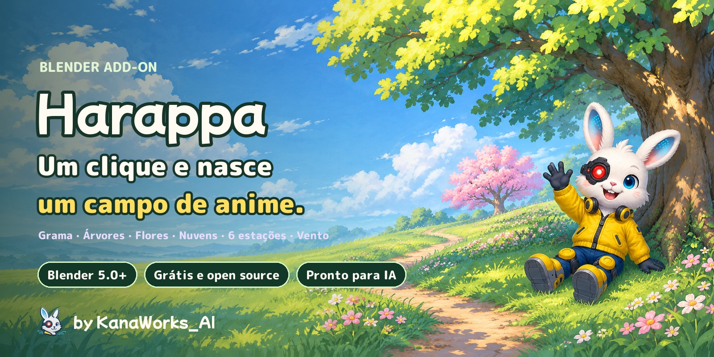
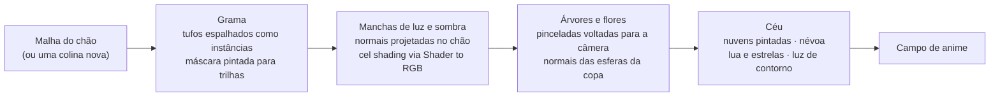

<div align="center">



<p>
  <a href="https://github.com/kanaworksai-hue/harappa/releases/latest"></a>
  
  
  
  
  <a href="LICENSE"></a>
  <a href="NOTICE.md"></a>
  <a href="https://github.com/kanaworksai-hue/harappa/stargazers"></a>
</p>

<p><a href="https://github.com/kanaworksai-hue"></a>&nbsp;<a href="https://github.com/kanaworksai-hue"><b>Um projeto da KanaWorks_AI</b></a>&nbsp;·&nbsp;<a href="#-add-ons-da-kanaworks">Veja a série</a></p>

[日本語](README.md) | [English](README.en.md) | [简体中文](README.zh-CN.md) | [한국어](README.ko.md) | **Português** | [Español](README.es.md)

[🎨 Galeria](#-galeria) · [🚀 Primeiros passos](#-primeiros-passos) · [🎛️ O que você pode ajustar](#️-o-que-você-pode-ajustar) · [❓ Perguntas frequentes](#-perguntas-frequentes) · [⭐ Dê uma estrela](#-apoie-com-uma-estrela)

</div>

**Harappa** (原っぱ, "campo aberto") é um add-on gratuito para o Blender que monta, com um clique, um campo no estilo dos cenários de anime: grama, árvores, flores e céu. Cada tufo de grama cresce por conta própria e balança ao vento, enquanto a luz e a sombra caem em grandes manchas pintadas. As árvores são feitas de folhas em pinceladas, e o céu ganha nuvens cúmulos pintadas e uma névoa ao longe.

Combine **6 estações** (Summer Meadow, Spring Blossom, Golden Hour, Autumn Leaves, Moonlit Night, Misty Morning) com **4 estilos de pintura** (Anime Background, Painterly, Crisp Cel, Soft Pastel). Cada clique em **Shuffle** (embaralhar) muda o formato das árvores, as nuvens e as cores das flores, e um agente de IA pode fazer tudo por você, da instalação à cena pronta.

<p align="center">
  
  <br><sub>Mesma colina, mesma câmera. À esquerda: nada ainda. À direita: depois de Make Anime Meadow.</sub>
</p>

## ✨ Recursos

<table>
<tr>
<td align="center" width="25%"><br><b>Um clique</b><br><sub>Grama, flores, céu, nuvens, sol e câmera, tudo de uma vez</sub></td>
<td align="center" width="25%"><br><b>Árvores de anime</b><br><sub>Redonda, alta, larga estilo cerejeira, arbusto e conífera</sub></td>
<td align="center" width="25%"><br><b>6 estações × 4 estilos</b><br><sub>O Shuffle muda árvores, nuvens, cores das flores e luz</sub></td>
<td align="center" width="25%"><br><b>Peça ao seu agente de IA</b><br><sub>Uma frase: instalação, cena e prévia, tudo feito por você</sub></td>
</tr>
</table>

- **Grama de cenário de anime:** a grama é um campo de instâncias de tufos, então continua leve. Ela balança com um vento em duas camadas (ondas lentas mais uma vibração rápida), enquanto faixas de luz atravessam o campo junto com as rajadas. Luz e sombra vêm de um campo de normais em "manchas" compartilhado pelo chão e por cada folha de grama, de modo que as sombras caem em grandes manchas que acompanham o sol. As raízes são mais escuras, as pontas mais claras, e cada folha de grama é um pouco diferente.
- **Trilhas são só pintura:** o Paint Path (pintar trilha) muda para o Vertex Paint; onde você pinta de preto, a grama some e vira uma trilha de terra. As bordas se desfiam de forma natural, e ali a grama fica mais baixa e mais rala.
- **Árvores de pinceladas:** as folhas são cards voltados para a câmera, cobertos de pinceladas, com normais vindas das esferas da copa, de modo que cada tufo se divide em áreas iluminadas, de meio-tom, de sombra e bolsões escuros. As flores nascem em cachos no lado ensolarado, e na primavera todas as árvores e arbustos florescem. Mude o formato, a altura ou a seed e a árvore se reconstrói na hora.
- **Céu, nuvens e névoa:** as nuvens cúmulos pintadas são posicionadas longe das copas das árvores e das bordas do quadro, e o que está distante se dissolve na cor do horizonte. A noite traz lua e estrelas; a golden hour coloca uma luz quente nas bordas das árvores.
- **Qualquer malha vira arbusto:** o Make Foliage (criar folhagem) transforma a Suzanne, uma caixa ou qualquer outra coisa em uma cerca viva ou arbusto de pinceladas de folhas.
- **A grama contorna os seus personagens:** coloque uma coleção na entrada **Avoid** dos modificadores Harappa Grass / Harappa Flowers e nada cresce debaixo desses objetos. A grama ao lado fica mais curta e se inclina para fora, de modo que um personagem deitado no campo parece aninhado nele, sem folhas atravessando o modelo.
- **Leve e rápido:** grama, folhas e nuvens continuam como instâncias, então a viewport continua responsiva e uma renderização em 1920×1080 leva segundos. Os valores ficam em node groups, então os arquivos renderizam igual mesmo sem o add-on instalado.
- **Interface em English, 日本語, 简体中文 e 한국어:** segue automaticamente o idioma do Blender, ou escolha um no menu 🌐 no canto superior direito do painel.

## 🎨 Galeria

### Seis estações

Mesmo campo, mesma câmera — só a estação muda.


### Balançando ao vento

Grama, flores e árvores se movem com as ondas de vento.


### Cinco formatos de árvore


### De perto


### Quatro estilos de pintura

Estações e estilos podem ser combinados livremente.


### Shuffle

Cada clique muda o formato das árvores, a disposição das nuvens, as cores das flores, o tom da grama e o ângulo do sol. Guarde o número e você pode recuperar a mesma cena quando quiser.


### Qualquer malha vira arbusto


### Quatro camadas


## 🧭 Como funciona



1. **Grama (Geometry Nodes):** os tufos são espalhados pelo chão e mantidos como instâncias. Onde a máscara pintada (atributo de cor `hrp_grass`) é preta, nada cresce; nas bordas, a grama fica mais baixa, mais rala e se move menos. A grama longe da câmera é rareada e fica um pouco maior para manter o desempenho. A normal do chão, a máscara e a onda de vento são guardadas por tufo para o shader.
2. **Manchas de luz e sombra (shader):** "cúpulas" de Voronoi projetadas diretamente para baixo no espaço do mundo (em três tamanhos) são somadas à normal do chão e então iluminadas por Diffuse → Shader to RGB → normalizadas pela luz principal → divisão cel em 3 tons. A grama e o chão usam a mesma projeção, então as manchas de sombra atravessam o campo inteiro, e um ruído fino quebra a linha de transição em traços parecidos com folhas de grama. Segue a técnica de grama de anime de projetar uma textura de normais no espaço do objeto; o Harappa faz isso de forma procedural com nodes, sem bake.
3. **Árvores e flores:** a copa é uma malha de esferas sobrepostas (edite-a e a árvore muda de forma). A superfície é coberta por cards de folhas alinhados à câmera (um atlas de pinceladas desenhado com numpy), com normais vindas das esferas e da copa inteira. AO e profundidade escurecem o interior, e cada card recebe um valor levemente diferente, para que as pinceladas pareçam marcas de pincel sobrepostas.
4. **Céu:** as nuvens usam a mesma técnica de cards, sombreadas com uma normal esférica por nuvem calculada a partir do centro de cada uma, de modo que as bordas fofas continuam com cara de desenho à mão enquanto a sombra se lê como uma única massa. Todo material se dissolve na cor do horizonte conforme a distância da câmera.

## 🚀 Primeiros passos

### Peça ao seu agente de IA (recomendado)

Se você usa um agente de IA capaz de operar o seu computador (Claude Code, Codex, …), é só enviar isto:

> Siga o AGENTS.md em https://github.com/kanaworksai-hue/harappa para instalar o Harappa e criar para mim, no Blender, um campo no estilo de cenário de anime com árvores.

Depois, faça os ajustes finos em linguagem comum enquanto olha a prévia:

- "Deixe com cara de pôr do sol."
- "Uma cerejeira no meio."
- "Adicione uma trilha atravessando o campo."
- "Mais nuvens."
- "Me mostre outra versão."

### Instale você mesmo

**Você precisa de:** Blender 5.0 ou mais recente (testado no Blender 5.2 LTS e 5.3), com o EEVEE como motor de renderização.

1. Baixe o `harappa-x.y.z.zip` em [Releases](https://github.com/kanaworksai-hue/harappa/releases/latest) (não descompacte)
2. Blender → Edit → Preferences → Get Extensions → ⌄ no canto superior direito → **Install from Disk…** (instalar do disco) → escolha o zip


### Use

1. Na 3D view, pressione **N** → aba **Harappa**
2. **Make Anime Meadow** (criar campo de anime; na malha de chão selecionada, ou em uma colina nova quando nada está selecionado)
3. **Add Anime Tree** (adicionar árvore de anime; aparece no 3D cursor) ou **Plant Trees** (plantar árvores; espalha árvores pelo campo)
4. Para uma trilha, use **Paint Path** em Active Meadow e pinte de preto
5. Escolha uma **Season** (estação) e um **Paint Style** (estilo de pintura). Não consegue decidir? **Shuffle**. Renderize com **F12**

<p align="center">
  
</p>

## 🎛️ O que você pode ajustar

<details>
<summary><b>Painel principal</b></summary>

| Opção | O que faz |
|---|---|
| Make Anime Meadow | Grama e flores nas malhas selecionadas (ou em uma colina nova), além de céu, sol, nuvens, colinas ao longe e uma câmera |
| Tree Shape / Height / Blossom → Add Anime Tree | Uma árvore no chão, sob o 3D cursor |
| Plant Trees / Trees | Espalha árvores pelo campo ativo (evitando as trilhas e o campo de visão da câmera) |
| Season / Paint Style | Cores, luz e céu (6) / como a luz e a sombra são pintadas (4) |
| Variation / Shuffle | Um número que sorteia de novo o formato das árvores, as nuvens, as cores das flores, os tons e o ângulo do sol; 0 restaura o original |
| Add Clouds / Clouds | Recria os cúmulos pintados (0 os remove) |
| Make Foliage | Transforma as malhas selecionadas em arbustos ou cercas vivas de pinceladas de folhas |
| Anime Sky & Sun | Muda para o EEVEE, a visualização Standard, o céu de anime e um sol principal |
| Remove Grass / Reset to Defaults | Remove grama, flores e folhas dos objetos selecionados e restaura seus materiais / Summer, Anime Background, sem variação |

</details>

<details>
<summary><b>Active Meadow e Active Tree</b></summary>

| Grupo | Opções |
|---|---|
| Paint Path / Paint Grass | Vertex paint: preto = trilha, branco = grama |
| Grass | Density, Height, Height Random, Width, Edge Shrink, LOD Distance, Seed |
| Wind | Wind Strength, Speed, Scale, Direction, Edge Wind |
| Flowers | Density, Patch Size, Patch Amount, Size, Height, Seed |
| Tree | Tree Shape, Leaf Style, Height, Seed (mudar qualquer um deles reconstrói a árvore), New Shape |
| Leaves | Density, Leaf Size, Size Random, Inflate, Roundness, Blossom, Blossom Scale, Fill Inside, Seed |
| Tint | Hue Shift e Brightness por árvore |
| Shape Canopy | Mova ou adicione esferas da copa no Edit Mode; as folhas acompanham em tempo real |

</details>

<details>
<summary><b>Light & Sky, Brushwork, Colours</b></summary>

| Grupo | Opções |
|---|---|
| Light & Sky | Sun Height e Direction, Light / Shadow Split, Deep Shadow Split, Edge Softness, Rim Light, Haze (quantidade, início, fim), cores do céu |
| Brushwork | Clump Size e Strength, Small Clumps, Brush Jitter, Dark Roots, Light Tips, Wind Sheen, Colour Patches, Leaf Pockets, Leaf Highlights |
| Colours | Todas as cores da grama, da trilha, das folhas, das flores das árvores e da casca, das nuvens e das flores |

As estações só mudam valores de cor e luz, e os estilos só mudam valores de técnica, então qualquer estação combina com qualquer estilo.
</details>

## ❓ Perguntas frequentes

<details>
<summary><b>Funciona no Cycles?</b></summary>

Não. Ele usa o node Shader to RGB do EEVEE, então renderize com o EEVEE. Ao criar seu primeiro campo ou árvore, a cena muda para o EEVEE.
</details>

<details>
<summary><b>Quando giro a viewport, as folhas e as nuvens parecem cards finos.</b></summary>

Os cards de folhas, flores e nuvens ficam voltados para a **câmera da cena** (igual à técnica de árvores de anime em que ele se baseia). Confira o visual pela câmera (Numpad 0) e renderize a partir da câmera; mova a câmera e os cards acompanham.
</details>

<details>
<summary><b>Posso fazer a grama crescer no meu próprio chão?</b></summary>

Sim. Selecione a sua malha de chão e clique em Make Anime Meadow. Pintar uma trilha exige vértices, então subdivida antes um plano simples. O Remove Grass devolve o seu material original.
</details>

<details>
<summary><b>Não vai ficar pesado?</b></summary>

Grama, folhas e nuvens continuam como instâncias, e a grama distante é rareada automaticamente. Se estiver lento, diminua a Density em Active Meadow ou encurte a LOD Distance. As amostras de renderização ficam em 16, o que é mais do que suficiente para cel shading.
</details>

<details>
<summary><b>Posso usar comercialmente as imagens e os vídeos que eu criar?</b></summary>

Sim. As renderizações e os vídeos feitos com o Harappa são obra sua e de uso livre, inclusive comercial. A GPL se aplica ao código do add-on, não ao que você cria com ele. Não é preciso dar crédito, mas um `Made with Harappa by @KanaWorks_AI` é sempre bem-vindo.
</details>

## 📝 Crédito

O Harappa é gratuito, inclusive para uso comercial.

**Ao redistribuir, modificar ou incluir o add-on em um pacote** (forks, versões modificadas, ports, packs ou produtos que o incluam, gratuitos ou pagos), é **obrigatório** manter esta linha, sem alterações, na descrição do add-on e na sua documentação (um termo adicional sob a seção 7(b) da GPLv3; veja [NOTICE.md](NOTICE.md)):

```
Harappa by KanaWorks_AI (@KanaWorks_AI) — https://github.com/kanaworksai-hue/harappa
```

**As imagens e os vídeos que você cria** não precisam de crédito. Se quiser incluir um, esta linha na publicação ou na descrição é muito bem-vinda:

```
Made with Harappa by @KanaWorks_AI
```

## ⭐ Apoie com uma estrela

Se você gostou do Harappa, uma **⭐ Star** no canto superior direito da [página do repositório](https://github.com/kanaworksai-hue/harappa) significa muito. É de graça e leva um segundo.

- **Chega a mais pessoas:** mais estrelas facilitam encontrá-lo no GitHub.
- **Mantém as atualizações vindo:** é uma motivação de verdade para novos formatos de árvore e novas estações.

Relatos de bugs e ideias de recursos em [Issues](https://github.com/kanaworksai-hue/harappa/issues), e as suas renderizações marcando [@KanaWorks_AI](https://x.com/KanaWorks_AI) no X, são igualmente bem-vindos.

## 🧩 Add-ons da KanaWorks

Add-ons gratuitos e de código aberto para o Blender, do mesmo autor. Todos eles funcionam com um pedido de uma frase a um agente de IA.

<table>
<tr>
<td align="center" width="50%"><a href="https://github.com/kanaworksai-hue/harappa"></a><br><b>Harappa</b> (esta página)<br><sub>Campos, árvores, flores e céu de cenário de anime em um clique</sub></td>
<td align="center" width="50%"><a href="https://github.com/kanaworksai-hue/senga-sketch"></a><br><b><a href="https://github.com/kanaworksai-hue/senga-sketch">Senga Sketch</a></b><br><sub>Do 3D para arte em traço de nanquim: hachura, lápis, gravura, retícula</sub></td>
</tr>
<tr>
<td align="center" width="50%"><a href="https://github.com/kanaworksai-hue/painterly-25d"></a><br><b><a href="https://github.com/kanaworksai-hue/painterly-25d">Painterly 2.5D</a></b><br><sub>Do 3D para arte pintada à mão: óleo, aquarela, giz de cera, cel de anime</sub></td>
<td align="center" width="50%"><a href="https://github.com/kanaworksai-hue/kirapaint"></a><br><b><a href="https://github.com/kanaworksai-hue/kirapaint">KiraPaint</a></b><br><sub>Do 3D para um 2.5D pictórico e cintilante: brilho de diamante triturado e luz de estrelas</sub></td>
</tr>
<tr>
<td align="center" width="50%"><a href="https://github.com/kanaworksai-hue/mochitoon"></a><br><b><a href="https://github.com/kanaworksai-hue/mochitoon">MochiToon</a></b><br><sub>Do 3D para um visual fofo de quadrinhos: sombras coloridas, retículas de coração e estrela</sub></td>
<td align="center" width="50%"></td>
</tr>
</table>

## 🛠️ Desenvolvimento

```bash
# Teste headless (todos os recursos numa cena para a qual nunca foram ajustados)
blender -b --factory-startup --python tests/test_generic.py

# Gera o zip instalável em dist/
BLENDER=blender ./build.sh
```

```
harappa/
  __init__.py      configurações, estações, estilos, variação, operadores
  shading.py       shaders (paleta, normais das manchas da grama, cel shading, chão/grama/flor/folha/casca/nuvem, névoa)
  scatter.py       Geometry Nodes (vento, grama, flores, cards de folhas e nuvens)
  tree.py          gerador de tronco e copa, objetos de asset
  clouds.py        posicionamento das nuvens e colinas ao longe
  assets.py        tufo de grama, cards, atlas de folhas/flores/nuvens desenhados com numpy
  scene.py         configurações do EEVEE, céu de anime (lua e estrelas), sol principal
  presets.py       estações e estilos
  build.py         transforma um chão em campo
  ui.py / i18n.py  painel e traduções da interface (日本語, English, 简体中文, 한국어)
agent/harappa_agent.py  linha de comando para agentes de IA
```

## 📄 Licença e créditos

- **Este add-on:** Copyright © 2026 東京AI映像合同会社 (Tokyo AI Visuals LLC), publicado sob a [GPL-3.0-or-later](LICENSE) com um termo adicional de atribuição para redistribuição ([NOTICE.md](NOTICE.md)).
- **Marca:** o nome KanaWorks_AI, o logotipo e a personagem Kana pertencem à 東京AI映像合同会社 e **não** estão cobertos pela GPL. Veja [docs/brand](docs/brand/README.md).
- O visual da grama e das árvores se apoia em técnicas amplamente compartilhadas pela comunidade de cenários de anime no Blender: normais projetadas que dão a um campo manchas de sombra coerentes, cards de folhas voltados para a câmera com normais vindas de esferas e cel shading via Shader to RGB. Aprendemos muito com os tutoriais de grama e árvores de anime de Trung Duy Nguyen ([@trungduyng](https://www.youtube.com/@trungduyng)). Todos os nodes e o código do Harappa foram escritos do zero, e todas as texturas são desenhadas proceduralmente pelo próprio add-on.
- **Blender** é uma marca registrada da Blender Foundation. Este é um projeto independente, sem afiliação com a Blender Foundation nem endosso dela.

<br>

<div align="center">

<a href="https://x.com/KanaWorks_AI"></a>

<p><b>Feito com ♥ por <a href="https://x.com/KanaWorks_AI">KanaWorks_AI</a></b></p>

<p><sub>Se o Harappa te ajudou, uma ⭐ mantém a próxima atualização vindo. Mais projetos: <a href="https://github.com/kanaworksai-hue">github.com/kanaworksai-hue</a></sub></p>

</div>
