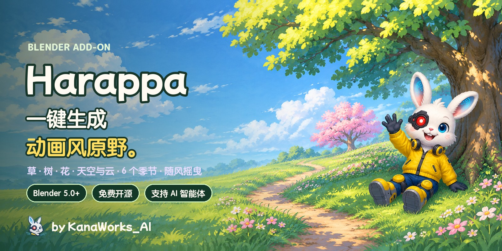
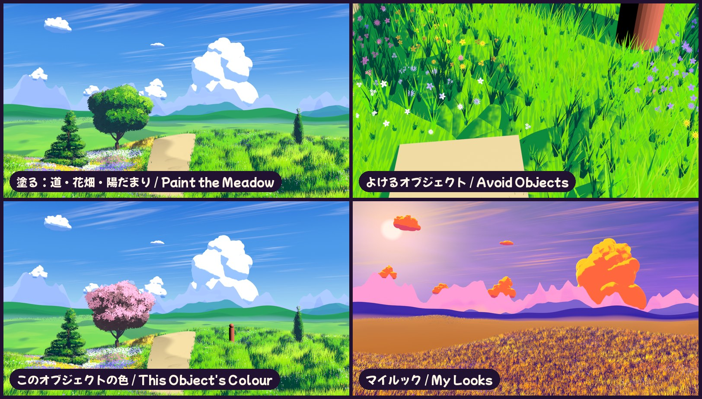

<div align="center">



<p>
  <a href="https://github.com/kanaworksai-hue/harappa/releases/latest"></a>
  
  
  
  
  <a href="LICENSE"></a>
  <a href="NOTICE.md"></a>
  <a href="https://github.com/kanaworksai-hue/harappa/stargazers"></a>
</p>

<p><a href="https://github.com/kanaworksai-hue"></a>&nbsp;<a href="https://github.com/kanaworksai-hue"><b>KanaWorks_AI 的项目</b></a>&nbsp;·&nbsp;<a href="#-kanaworks-插件">系列一览</a></p>

[日本語](README.md) | [English](README.en.md) | **简体中文** | [한국어](README.ko.md) | [Português](README.pt-BR.md) | [Español](README.es.md)

[🎨 作品展示](#-作品展示) · [🚀 快速上手](#-快速上手) · [🎛️ 可调整的内容](#️-可调整的内容) · [❓ 常见问题](#-常见问题) · [⭐ 点个 Star](#-点个-star-支持一下)

</div>

**Harappa（原っぱ，原野）** 是一款免费的 Blender 插件，一键就能做出动画背景一样的草地、树、花和天空。每一丛草都单独生长、随风摇曳，光影按大块的「草团」分开上色；树由笔触般的叶片组成，天空里有手绘风的立体积云、层层叠叠的远山和空气透视。

**夏日草原、春日花开、黄金时刻、秋日红叶、月夜、薄雾清晨** 6 个季节，可以和 **动画背景、绘画风、硬边赛璐璐、柔和粉彩** 4 种画风自由组合。每按一次 **随机**，树的形状、云和花的颜色都会变化；从安装到搭好场景，也可以一句话交给 AI 智能体。

**1.1 新功能：** 用笔刷画出小路、花坛、高草和阳光斑；让草给你的角色让出空间；给任意一棵树、一朵云或一片草地单独上色；还能把喜欢的配色存成 **外观**，在任何文件里使用。

<p align="center">
  
  <br><sub>同一座山丘、同一台相机。左边是空的，右边是点了「生成动画草原」之后。</sub>
</p>

## ✨ 特点

<table>
<tr>
<td align="center" width="25%"><br><b>一键完成</b><br><sub>草、花、天空、云、太阳和相机一次到位</sub></td>
<td align="center" width="25%"><br><b>动画风的树</b><br><sub>九种树形：圆形树、樱花树、日本松、垂柳、杨树……</sub></td>
<td align="center" width="25%"><br><b>6 个季节 × 4 种画风</b><br><sub>随机切换树形、云、花色和光线</sub></td>
<td align="center" width="25%"><br><b>交给 AI</b><br><sub>一句话，从安装到搭好场景全自动</sub></td>
</tr>
</table>

- **动画背景的草：** 草是一丛丛的实例，所以很轻；用两层风（缓慢的波浪和细碎的抖动）摇曳，风过之处还有一道道光扫过草地。地面和每根草共用一个「草团」法线场来分光影，所以阴影是成块的，并且会随太阳方向变化。根部偏暗、草尖偏亮，每根草的颜色都略有不同。
- **绘制草地：** 四个笔刷图层——**草**（开小路 / 长草）、**花**（茂密的花坛 / 去掉花）、**草的高度**（最高两倍 / 像修剪过一样矮）和 **颜色**（阳光斑、枯黄处）。点一个图层，用 Blender 自带的笔刷画，草会随着笔触当场变化。全部填满、重置本层和 Ctrl+Z 都能用，切换季节、随机和恢复默认也会保留你画的内容。
- **笔触感的树：** 叶片是始终朝向相机的「笔触」卡片，法线取自树冠的球体，所以每一团都会分成亮部、中间调、阴影和深处的暗部。共有九种树形，从圆形阔叶树到樱花树、日本松、垂柳和杨树；「种树」会把一棵圆形的主角树放在画面的三分线上。改变形状、高度或种子，树会当场重建。
- **天空、云和远山：** 跟随相机的天空渐变、太阳圆盘和高空卷云；立体的积云（每一朵都是可以移动、缩放或删除的物体）顶部受光、阴影偏蓝，迎着太阳的一侧镶着金边；最多三层远山渐渐融入空气透视。夜晚有月亮和星星，黄金时刻则是逆光。
- **任何网格都能变成灌木：** 「生成树叶」可以把猴头 Suzanne、方盒子等任何网格变成树篱或灌木。
- **草会绕开角色和石头：** 选中你的角色（或它的骨架），点 **让草避开它**。角色内部不会长草，旁边的草会变矮并向外倒；悬在地面上方的东西（长椅、桥）下面，草只长到它的下方为止。过渡是连续的，角色移动时草也不会突然跳变。**使用简单包围盒** 能让很重的模型也保持流畅。
- **每个物体都有自己的颜色：** 可以单独调整某一片草地、一棵树、一朵云或一组远山的色相、饱和度和明度，也可以给它一个自有颜色（比如绿树中间的一棵粉色樱花）。按「随机」也会保留。
- **我的外观：** 把颜色、光线、天空和画风存成一个小小的 JSON 文件，套用到任何场景；还能导入、导出外观，分享给别人。
- **细节档位：** 快速 / 均衡 / 最佳，一键在丰富程度和速度之间取舍（同时也会设置渲染采样）。
- **又轻又快：** 草、叶、花都保持实例，视图操作流畅，1920×1080 在 M1 Mac 上渲染大约四秒。数值保存在节点组里，没装插件也能渲染出同样的效果。
- **界面支持 日本語、English、简体中文、한국어：** 自动跟随 Blender 的语言设置，也可以在面板右上角的 🌐 菜单单独切换。

## 🎨 作品展示

### 6 个季节

同一片原野、同一台相机，只切换了季节。


### 随风摇曳

草、花和树都会随着风的波浪摆动。


### 9 种树形


### 近看细节


### 4 种画风

季节和画风可以分别选择。


### 随心定制

画一条小路、一片花坛和一块阳光斑；让草给野餐垫和角色让出空间；把一棵树染成粉色；再把保存的外观套用到一个新文件上。



### 随机

每按一次，树形、云的位置、花色、草的色调和太阳角度都会改变。记住编号，随时都能还原同一个场景。


### 任何网格都能变成灌木


### 4 个图层


## 🧭 原理


1. **草（几何节点）：** 在地面上散布草丛并保持实例。笔刷图层是地面上的颜色属性（`hrp_grass`、`hrp_flowers`、`hrp_height`、`hrp_tint`），缺少的图层不会改变任何东西。`hrp_grass` 为黑色的地方不长草，边缘处的草更矮、更稀、摆动更小。离相机远的草会自动减少并稍微变大，保证速度。每丛草的地面法线、遮罩值和风的波浪都会存成属性，供着色器读取。
2. **光影草团（着色器）：** 在世界坐标中从正上方投影的 Voronoi「小山包」（大、中、小三层）叠加到地面法线上，经过 Diffuse → Shader to RGB → 按主光强度归一化 → 三阶赛璐璐上色。草和地面用同一个投影，所以阴影团会横跨整片草地；再用细噪声把明暗交界打散成草叶般的笔触。参考的是在物体空间投影法线贴图的动画草地画法，Harappa 用程序化节点实现，无需烘焙。
3. **树和花：** 树冠是互相重叠的球体网格（编辑它就能改变树形）。表面铺满朝向相机的叶片卡片（用 numpy 绘制的笔触图集），法线取自球体和整个树冠；用 AO 和深度压暗内部，每张卡片的明度略有差异，让笔触看起来层层叠叠。
4. **天空：** 渐变、太阳和卷云画在世界着色器里，并会随相机重新适配。每朵云由一团团云块组成，再变成平滑的网格（SDF 体积 → 网格），按每个云块用画师式的光照上明暗，所以受光的顶部、偏蓝的阴影和平坦的底部看起来就像背景画。所有材质都会随相机距离融入地平线颜色。

## 🚀 快速上手

### 交给 AI 智能体（推荐）

如果你在用 Claude Code、Codex 这类能操作电脑的 AI 智能体，只要发这一句：

> 按照 https://github.com/kanaworksai-hue/harappa 的 AGENTS.md 安装 Harappa，在 Blender 里帮我做一片动画背景风的原野和树。

之后看着预览，一句话就能修改：

- 「改成黄昏」
- 「在中间种一棵樱花树」
- 「加一条小路」
- 「多来点云」
- 「换一个版本看看」

### 自己安装

**需要：** Blender 5.0 及以上（已在 Blender 5.2 LTS 和 5.3 上测试），渲染引擎为 EEVEE。

1. 从 [Releases](https://github.com/kanaworksai-hue/harappa/releases/latest) 下载 `harappa-x.y.z.zip`（不要解压）
2. Blender → 编辑 → 偏好设置 → 获取扩展 → 右上角 ⌄ → **从磁盘安装…** → 选择 zip


### 使用方法

1. 在 3D 视图按 **N** → **Harappa** 标签
2. 点 **生成动画草原**（选中地面网格就长在上面，什么都没选就新建一座山丘）
3. 点 **添加动画树**（立在 3D 游标处）或 **种树**（在草地上随机种下）
4. **绘制草地：** 点 **草** 画一条小路（一开始就是 **开小路**），点 **花** 画花坛，也可以选 **草的高度** 或 **颜色**；画好后点 **画完了**
5. 选中你的角色，点 **让草避开它**；选中一棵树，在 **这个物体的颜色** 里选一个 **自有颜色**
6. 选择 **季节** 和 **画风**，拿不定主意就按 **随机**，喜欢就点 **保存外观**。按 **F12** 渲染

<p align="center">
  
</p>

## 🎛️ 可调整的内容

<details>
<summary><b>主面板</b></summary>

| 项目 | 说明 |
|---|---|
| 生成动画草原 | 在选中的网格（或新山丘）上长出草和花，并添加天空、太阳、云、远山和相机 |
| 树形 / 树高 / 花量 → 添加动画树 | 在 3D 游标下方的地面上种一棵树 |
| 种树 / 棵数 | 在当前草地上随机种树（避开小路和相机前方） |
| 季节 / 画风 | 颜色、光线和天空（6 种）/ 光影的画法（4 种） |
| 外观 / 保存外观 | 套用保存的外观（或季节默认）/ 把当前的颜色、光线、天空和画风存成外观；⌄ 里有导入、导出、文件夹和删除 |
| 鲜艳度 / 整体对比度 | 整个画面的色彩强度和对比度，换季时也会保留 |
| 细节档位 | 快速 / 均衡 / 最佳：草和花的多少、云的精细程度和渲染采样 |
| 变体 / 随机 | 重新随机树形、云、花色、色调和太阳角度的编号，0 = 还原 |
| 生成云 / 数量 | 重新布置云（0 = 删除），你移动过的云会保留 |
| 远山 / 层数 | 在草地周围放最多三层远山（再点一次换形状，0 = 删除） |
| 让草避开它 | 选中你自己的网格或骨架时显示：草会给它让出空间 |
| 生成树叶 | 把选中的网格变成树叶笔触的灌木或树篱 |
| 动画天空与太阳 | 切换到 EEVEE、标准视图、动画天空和主光太阳 |
| 移除草 / 恢复默认 | 移除选中物体上的草、花和树叶并恢复原材质 / 夏日草原、动画背景、无变体 |

</details>

<details>
<summary><b>绘制草地、避开物体、这个物体的颜色、当前草地 / 树木 / 云</b></summary>

| 分组 | 项目 |
|---|---|
| 绘制草地 | 图层：草 / 花 / 草的高度 / 颜色；每个图层两个动作（开小路 – 长草、多开花 – 去掉花、变高 – 变矮、画 – 去掉）和柔化；笔刷强度、画笔颜色 + 当季色块、全部填满 / 全部擦除、重置本层、画完了；自己的地面太粗时用「细分地面」 |
| 避开物体 | 避开选中 / 不再避开、列表、留空距离、最矮高度、使用简单包围盒；「更多」里有：向下作用高度、避开的集合 |
| 这个物体的颜色 | 色相偏移 / 饱和度偏移 / 明度偏移、自有颜色 + 比例、这棵树的花、复制给选中物体、恢复场景颜色 |
| 草 | 密度、高度、高度随机、宽度、边缘草变矮、LOD 距离、种子 |
| 风 | 风力、风速、风的尺度、风向、边缘摆动 |
| 花 | 密度、花丛大小、花丛数量、大小、高度、种子 |
| 树 | 树形、叶片样式、高度、种子（修改后当场重建）、换个形状 |
| 树叶 | 密度、叶片大小、大小随机、膨胀、整体圆润度、花量、花簇大小、填充内部、种子 |
| 塑造树冠 | 在编辑模式下移动、增加树冠球体，树叶实时跟随 |
| 选中的云 | 换个形状、高耸度、云的宽度、起伏大小、交还给自动布局 |

</details>

<details>
<summary><b>光照与天空 · 笔触 · 颜色</b></summary>

| 分组 | 项目 |
|---|---|
| 光照与天空 | 太阳高度和方向、明暗分界、深阴影分界、边缘柔和度、轮廓光、空气透视（强度、起点、终点）、天空颜色 |
| 笔触 | 草团大小和强度、小草团、笔触抖动、根部暗化、草尖提亮、风吹光泽、色块、树叶暗部空隙、树叶高光 |
| 颜色 | 草、小路、树叶、花朵与树皮、云、花的每一种颜色 |

季节只改「颜色和光」的数值，画风只改「画法」的数值，所以可以自由组合。
</details>

## ❓ 常见问题

<details>
<summary><b>能在 Cycles 里用吗？</b></summary>

不能。插件使用了 EEVEE 专用的 Shader to RGB 节点，请用 EEVEE 渲染。生成第一片草地或第一棵树时会自动切换到 EEVEE。
</details>

<details>
<summary><b>旋转视图时，树叶和云看起来像薄薄的卡片。</b></summary>

树叶、花和云的卡片会朝向**场景相机**（和参考的动画树画法一样）。请在相机视图（小键盘 0）下查看，并从相机渲染；移动相机时卡片也会跟着转。
</details>

<details>
<summary><b>能在自己的地面上长草吗？</b></summary>

可以。先选中地面网格再点「生成动画草原」。绘制需要顶点：如果你的地面是很粗的平面，在「绘制草地」里点 **细分地面** 一步就能加上（已经画的内容会保留）。用「移除草」可以恢复原来的材质。
</details>

<details>
<summary><b>会不会很卡？</b></summary>

草、树叶和云都保持实例，远处的草会自动减少。如果还是卡，可以降低「当前草地」里的密度，或缩短 LOD 距离。渲染采样设为 16（赛璐璐上色足够了）。
</details>

<details>
<summary><b>做出来的图片和视频可以商用吗？</b></summary>

可以。用 Harappa 渲染的图片和视频是你的作品，可以自由使用，包括商用。GPL 只适用于插件本身的代码，不适用于用它做出的作品。不需要署名，不过如果写上 `Made with Harappa by @KanaWorks_AI` 我们会很开心。
</details>

## 📝 署名

Harappa 免费，也可以商用。

**再分发、修改或打包本插件时**（fork、修改版、移植版、包含它的合集或产品，无论收费与否），**必须**在插件说明和文档中原样保留以下署名（依据 GPL-3.0 第 7 条 (b) 的附加条款，详见 [NOTICE.md](NOTICE.md)）：

```
Harappa by KanaWorks_AI (@KanaWorks_AI) — https://github.com/kanaworksai-hue/harappa
```

**你做出的图片和视频**不需要署名。如果愿意，在帖子或简介里加上这一行我们会很开心：

```
Made with Harappa by @KanaWorks_AI
```

## ⭐ 点个 Star 支持一下

如果你喜欢 Harappa，欢迎在[仓库页面](https://github.com/kanaworksai-hue/harappa)右上角点一下 **⭐ Star**。免费，只要一秒。

- **让更多人看到：** Star 越多，在 GitHub 上越容易被发现。
- **更新的动力：** 这是继续做新树形和新季节的最大动力。

也欢迎在 [Issue](https://github.com/kanaworksai-hue/harappa/issues) 里反馈 bug 和想要的功能，或者在 X 上带上 [@KanaWorks_AI](https://x.com/KanaWorks_AI) 分享你的作品。

## 🧩 KanaWorks 插件

同一作者的免费开源 Blender 插件，全部都能一句话交给 AI 智能体。

<table>
<tr>
<td align="center" width="50%"><a href="https://github.com/kanaworksai-hue/harappa"></a><br><b>Harappa</b>（本页）<br><sub>一键生成动画背景的原野、树、花和天空</sub></td>
<td align="center" width="50%"><a href="https://github.com/kanaworksai-hue/senga-sketch"></a><br><b><a href="https://github.com/kanaworksai-hue/senga-sketch">Senga Sketch</a></b><br><sub>把 3D 变成钢笔线画：排线、铅笔、铜版画、网点</sub></td>
</tr>
<tr>
<td align="center" width="50%"><a href="https://github.com/kanaworksai-hue/painterly-25d"></a><br><b><a href="https://github.com/kanaworksai-hue/painterly-25d">Painterly 2.5D</a></b><br><sub>把 3D 变成手绘画：油画、水彩、蜡笔、赛璐璐</sub></td>
<td align="center" width="50%"><a href="https://github.com/kanaworksai-hue/kirapaint"></a><br><b><a href="https://github.com/kanaworksai-hue/kirapaint">KiraPaint</a></b><br><sub>把 3D 变成闪闪发光的绘画风 2.5D：碎钻光泽和星光</sub></td>
</tr>
<tr>
<td align="center" width="50%"><a href="https://github.com/kanaworksai-hue/mochitoon"></a><br><b><a href="https://github.com/kanaworksai-hue/mochitoon">MochiToon</a></b><br><sub>把 3D 变成可爱漫画风：彩色阴影、爱心和星星网点</sub></td>
<td align="center" width="50%"></td>
</tr>
</table>

## 🛠️ 开发

```bash
# 无界面测试（在没有调过参数的场景中检查全部功能；tests/run_matrix.sh 可以用多个版本的 Blender 运行）
blender -b --factory-startup --python tests/test_generic.py
blender -b --factory-startup --python tests/test_custom.py

# 在 dist/ 生成安装用 zip
BLENDER=blender ./build.sh
```

```
harappa/
  __init__.py      设置、季节、画风、变体、操作
  shading.py       着色器（调色板、草团法线、赛璐璐上色、地面/草/花/叶/树皮/云、空气透视）
  scatter.py       几何节点（风、草、花、树叶和云的卡片）
  tree.py          树干和树冠生成、资产物体
  cumulus.py       立体积云及其布局
  ridges.py        远山的层
  layers.py        笔刷图层（绘制草地）
  avoid.py         避开物体
  look.py          这个物体的颜色
  looks.py         我的外观（保存 / 套用 / 导入 / 导出）
  quality.py       细节档位
  clouds.py        远处的丘陵（以及 1.0 的卡片云）
  assets.py        草丛、卡片、用 numpy 绘制的叶/花/云图集
  scene.py         EEVEE 设置、动画天空（月亮和星星）、主光太阳
  presets.py       季节和画风
  build.py         把地面变成草地
  ui.py / i18n.py  面板和界面翻译（日本語、English、简体中文、한국어）
agent/harappa_agent.py  给 AI 智能体用的命令行
```

## 📄 许可与致谢

- **本插件：** Copyright © 2026 东京AI映像合同会社，以 [GPL-3.0-or-later](LICENSE) 发布（附带再分发时需署名的附加条款，见 [NOTICE.md](NOTICE.md)）。
- **品牌：** KanaWorks_AI 的名称、logo 和角色 Kana 的权利归东京AI映像合同会社所有，**不在** GPL 授权范围内，详见 [docs/brand](docs/brand/README.md)。
- 草和树的表现参考了 Blender 动画背景社区广泛分享的方法：用投影法线让草地形成成块的阴影、朝向相机的树叶卡片配合球体法线、用 Shader to RGB 做赛璐璐上色等。尤其从 Trung Duy Nguyen（[@trungduyng](https://www.youtube.com/@trungduyng)）的动画草地和动画树教程中学到很多。Harappa 的节点和代码全部为原创，所有贴图都由插件以程序化方式绘制。
- **Blender** 是 Blender Foundation 的商标。本项目是独立项目，与 Blender Foundation 无关，也未获其认可。

<br>

<div align="center">

<a href="https://x.com/KanaWorks_AI"></a>

<p><b>Made with ♥ by <a href="https://x.com/KanaWorks_AI">KanaWorks_AI</a></b></p>

<p><sub>如果 Harappa 对你有帮助，一个 ⭐ 就是下一次更新的动力。更多项目：<a href="https://github.com/kanaworksai-hue">github.com/kanaworksai-hue</a></sub></p>

</div>
